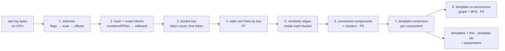
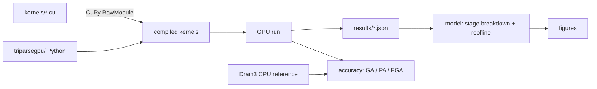
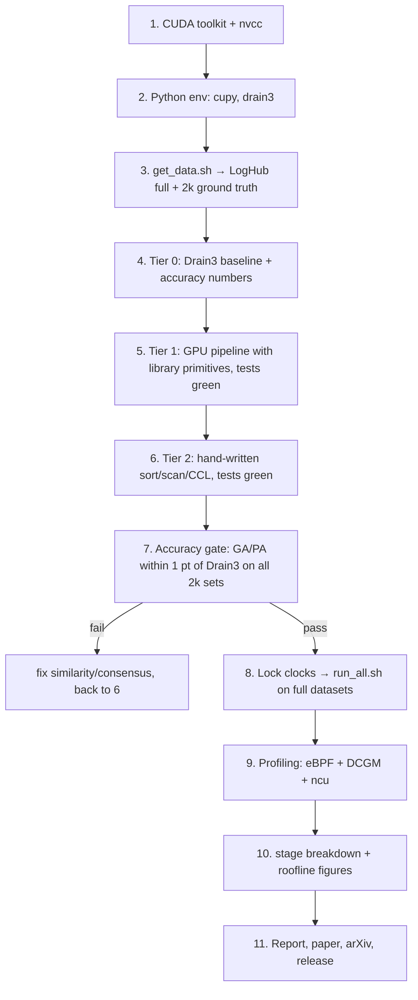
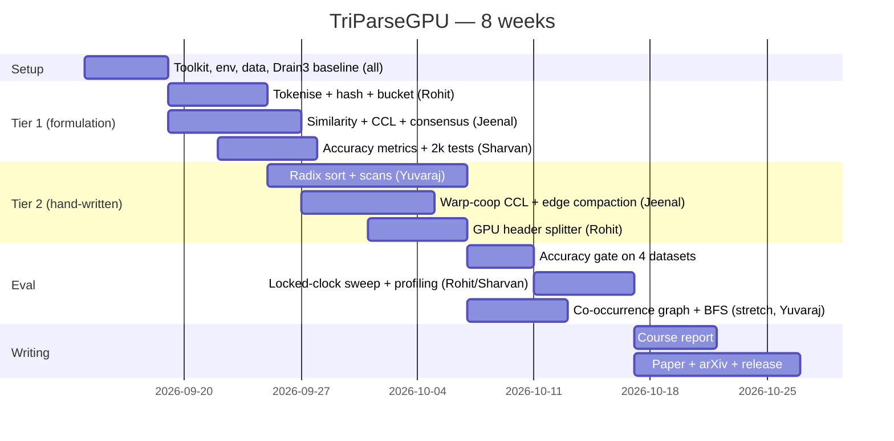

# TriParseGPU

**GPU-Native Log Template Mining for Large-Scale System Logs — Python-driven edition**

GPU Programming · M.Tech (AI) · IIT Jodhpur · Prof. Binod Kumar
Team: Rohit Patel (G25AIT2089) · Jeenal Chaudhary (G25AIT2027) · Kosuru Yuvaraj (G25AIT2054) · Sharvan Vittala (G25AIT2099)
Machine: NVIDIA RTX PRO 6000 Blackwell Max-Q · 96 GB · driver 595.58.03 · CUDA 13.2
Repo: `rpaut03l/triparsegpu` · BibTeX key `rohitpatel2026triparsegpu` · prior work `rohitpatel2026trishieldrag`, `rohitpatel2026tricalrag`

---

## 0. What this is, in plain terms

Every log-analysis and AIOps pipeline starts by turning raw log lines like
`connected to 10.0.0.7 port 22` and `connected to 10.0.0.9 port 22`
into a *template* `connected to <*> port <*>` plus its parameters. The standard algorithm is **Drain** (fixed-depth parse tree + token similarity). Every implementation — Drain3 (Python), the Go and C# ports — is single-threaded CPU code doing roughly 50k–200k lines/s. Production systems produce billions of lines a day, and every LLM-on-logs paper (including our own TriCalRAG) waits on this step.

**Gap:** no GPU implementation of template mining exists. The only GPU log work is regex filtering (RAPIDS, 2019).

**What we build:** a GPU parser that produces Drain-quality templates at 10M+ lines/s by reformulating Drain as three data-parallel problems from the course:

| Drain step | Data-parallel reformulation | Course problem |
|---|---|---|
| Tokenise, bucket by (length, first token) | line/token boundary **scan**, **radix sort** by bucket key | **P7** |
| Assign line to the first cluster with similarity ≥ threshold | similarity graph within a bucket + **connected-component labelling** | **P3** |
| Relate templates (which events go together) | BFS over a template co-occurrence graph (**CSR**) | **P2** |

Three tiers, as Sir's P7 requires (hand-written vs library primitives):

- **Tier 0** — Drain3 on CPU (the reference and the baseline)
- **Tier 1** — GPU pipeline using library primitives (`cupy.sort`, `cupy.cumsum`, CUB via CuPy)
- **Tier 2** — GPU pipeline with hand-written radix sort, Blelloch/decoupled-lookback scan, and union-find CCL kernels

The "Tri": three problems, three tiers, three contributions (parser, batch-Drain formulation, benchmark).



---

## 1. Why Python + CUDA strings

Same design as TriCluster: kernels are CUDA C++ text files compiled and launched from Python via CuPy `RawModule` (nvcc backend). Data loading, CPU reference (Drain3), accuracy metrics, timing, profiling drivers, plots and tests are Python. Hand-written kernels are the course deliverable; the Python is the harness.



---

## 2. Repository layout

```
triparsegpu/
├── README.md
├── LICENSE  (Apache-2.0)
├── CITATION.cff
├── pyproject.toml
├── kernels/
│   ├── common.cuh              hashing, masking helpers, block scan
│   ├── tokenize.cu             newline/space flags, boundary scan, token offsets
│   ├── hash.cu                 per-token 64-bit hash + wildcard masking
│   ├── radix.cu                tier-2 radix sort (histogram, scan, stable scatter)
│   ├── scan.cu                 Blelloch block scan + decoupled-lookback global scan
│   ├── similarity.cu           warp-per-line token-match similarity → edge list
│   ├── ccl.cu                  union-find / label-propagation CCL on edge list
│   ├── template.cu             per-component token consensus → template
│   └── cooccur.cu              windowed co-occurrence → CSR → BFS
├── triparsegpu/
│   ├── __init__.py
│   ├── compile.py              RawModule loader
│   ├── io.py                   dataset loader, header stripping (LogHub formats)
│   ├── tokenize.py             stage 1 driver
│   ├── hashing.py              stage 2 driver
│   ├── bucket.py               stages 3–4 (tier 1 uses cupy.sort, tier 2 uses radix.cu)
│   ├── cluster.py              stages 5–6
│   ├── template.py             stage 7
│   ├── graph.py                stage 8
│   ├── pipeline.py             end-to-end, returns templates + ids + stage timings
│   ├── ref_drain3.py           tier-0 reference runner
│   ├── metrics.py              GA, PA, FGA, FTA vs ground truth; parity vs Drain3
│   └── timing.py
├── bench/
│   ├── parsebench.py           CLI → results/<gpu>/*.json
│   ├── datasets.yaml
│   └── run_all.sh
├── model/
│   ├── stages.py               stage-time breakdown + throughput plots
│   ├── roofline.py             per-stage arithmetic intensity on the roofline
│   ├── ncu_extract.py · dcgm_extract.py · ebpf_extract.py
├── scripts/
│   ├── get_data.sh             LogHub full + LogHub-2k ground truth
│   ├── profile.sh              Nsight Compute (research box only)
│   ├── ebpf/  cuda_launch_latency.bt · cuda_sync_stalls.bt · nvidia_ioctl.bt
│   ├── lock_clocks.sh
│   └── reproduce.sh
├── tests/
│   ├── test_tokenize.py · test_sort.py · test_ccl.py · test_pipeline_accuracy.py
├── results/
└── paper/
```

---

## 3. Exact run sequence on the GPU machine



### Step 1 — CUDA toolkit (once)

```bash
nvidia-smi --query-gpu=name,driver_version,compute_cap,memory.total --format=csv
wget https://developer.download.nvidia.com/compute/cuda/repos/ubuntu2404/x86_64/cuda-keyring_1.1-1_all.deb
sudo dpkg -i cuda-keyring_1.1-1_all.deb && sudo apt-get update
sudo apt-get install -y cuda-toolkit-13-2 nsight-compute nsight-systems
echo 'export PATH=/usr/local/cuda/bin:$PATH' >> ~/.bashrc
echo 'export LD_LIBRARY_PATH=/usr/local/cuda/lib64:$LD_LIBRARY_PATH' >> ~/.bashrc
source ~/.bashrc && nvcc --version
```

### Step 2 — Python environment

```bash
git clone git@github.com:rpaut03l/triparsegpu.git && cd triparsegpu
python3 -m venv .venv && source .venv/bin/activate
pip install --upgrade pip
pip install cupy-cuda13x numpy pandas matplotlib pyyaml pytest drain3 regex tqdm
python -c "import cupy, drain3; print(cupy.__version__)"
```

### Step 3 — Data

`scripts/get_data.sh`:

```bash
#!/usr/bin/env bash
set -e
mkdir -p data/full data/2k
# Full datasets (already on this machine from TriCalRAG — symlink instead of re-downloading)
# Zenodo record 8196385: BGL.tar.gz, HDFS_v1.zip, Thunderbird.tar.gz, OpenStack.tar.gz
ln -sfn ~/datasets/loghub data/full
# LogHub-2k with ground-truth templates (parsing benchmark standard)
git clone --depth 1 https://github.com/logpai/logparser /tmp/logparser
for D in BGL HDFS Thunderbird OpenStack; do
  cp -r /tmp/logparser/data/loghub_2k/$D data/2k/
done
ls data/2k/*/*_2k.log_structured.csv
```

The `_structured.csv` files carry `Content` and `EventTemplate` columns — that's the accuracy ground truth. Also grab LogHub-2.0 (Zenodo, 2023) later for the larger annotated sets; the paper is stronger with both.

Line counts you'll be reporting throughput on: BGL ≈ 4.7M, HDFS ≈ 11.2M, Thunderbird ≈ 211M, OpenStack ≈ 0.2M.

### Step 4 — Tier 0: Drain3 baseline

`triparsegpu/ref_drain3.py`:

```python
import time, pandas as pd
from drain3 import TemplateMiner
from drain3.template_miner_config import TemplateMinerConfig

def run(contents, sim_th=0.4, depth=4, masking=True):
    cfg = TemplateMinerConfig()
    cfg.drain_sim_th = sim_th; cfg.drain_depth = depth
    if masking:
        cfg.masking_instructions = [
            {"regex_pattern": r"((?<=[^A-Za-z0-9])|^)(\d+\.\d+\.\d+\.\d+)((?=[^A-Za-z0-9])|$)", "mask_with": "IP"},
            {"regex_pattern": r"((?<=[^A-Za-z0-9])|^)(0x[a-f0-9A-F]+)((?=[^A-Za-z0-9])|$)", "mask_with": "HEX"},
            {"regex_pattern": r"((?<=[^A-Za-z0-9])|^)([\-\+]?\d+)((?=[^A-Za-z0-9])|$)", "mask_with": "NUM"},
        ]
    tm = TemplateMiner(config=cfg)
    t0 = time.perf_counter(); ids = []
    for line in contents:
        r = tm.add_log_message(line); ids.append(r["cluster_id"])
    dt = time.perf_counter() - t0
    templates = {c.cluster_id: c.get_template() for c in tm.drain.clusters}
    return ids, templates, dt

if __name__ == "__main__":
    import sys
    df = pd.read_csv(sys.argv[1])
    ids, tpl, dt = run(df.Content.astype(str).tolist())
    print(f"{len(df)} lines  {len(tpl)} templates  {len(df)/dt:,.0f} lines/s")
```

```bash
for D in BGL HDFS Thunderbird OpenStack; do
  python -m triparsegpu.ref_drain3 data/2k/$D/${D}_2k.log_structured.csv
done
# then the full-size baseline (this is slow — that's the point; run in screen)
screen -S drain3_full python -m triparsegpu.ref_drain3 data/full/BGL/BGL.log --raw
```

Record lines/s per dataset. This is the number every later table divides by.

### Step 5 — Tier 1: GPU pipeline with library primitives

Stages 1–7 in Python + CuPy, using `cupy.cumsum`, `cupy.argsort`, and small custom kernels only where no primitive exists (similarity, consensus). This tier proves the *formulation* before the hand-written kernels exist.

`triparsegpu/io.py` — LogHub header stripping (per-dataset format strings from logparser), result is a single `bytes` buffer plus line offsets:

```python
import re, numpy as np
FORMATS = {   # from logpai/logparser benchmark settings
  "BGL":         r"<Label> <Timestamp> <Date> <Node> <Time> <NodeRepeat> <Type> <Component> <Level> <Content>",
  "HDFS":        r"<Date> <Time> <Pid> <Level> <Component>: <Content>",
  "Thunderbird": r"<Label> <Timestamp> <Date> <User> <Month> <Day> <Time> <Location> <Component>(\[<PID>\])?: <Content>",
  "OpenStack":   r"<Logrecord> <Date> <Time> <Pid> <Level> <Component> \[<ADDR>\] <Content>",
}
def _regex(fmt):
    parts = re.split(r"(<[^<>]+>)", fmt); out = ""
    for p in parts:
        if not p: continue
        if p.startswith("<") and p.endswith(">"): out += f"(?P{p}.*?)" if p != "<Content>" else "(?P<Content>.*)"
        else: out += re.sub(r" +", r"\\s+", p)
    return re.compile("^" + out + "$")
def load_contents(path, dataset, limit=None):
    rx = _regex(FORMATS[dataset]); buf = bytearray(); offs = [0]
    with open(path, "r", errors="ignore") as f:
        for i, line in enumerate(f):
            if limit and i >= limit: break
            m = rx.match(line.rstrip("\n"))
            c = (m.group("Content") if m else line.rstrip("\n")).encode("utf-8", "ignore")
            buf += c + b"\n"; offs.append(len(buf))
    return np.frombuffer(bytes(buf), np.uint8), np.asarray(offs, np.int64)
```

Header stripping is CPU regex in tier 1; a GPU header-splitter (fixed-column datasets can be split by the k-th space via the same flag/scan trick) is a tier-2 extension.

`triparsegpu/tokenize.py` (stage 1, tier 1 = CuPy primitives):

```python
import cupy as cp
def tokenize(buf_gpu: cp.ndarray, line_offs: cp.ndarray):
    is_space = (buf_gpu == 32) | (buf_gpu == 10)
    prev_space = cp.concatenate([cp.array([True]), is_space[:-1]])
    tok_start = (~is_space) & prev_space                 # first byte of a token
    tok_id = cp.cumsum(tok_start, dtype=cp.int64) - 1    # global token index (scan)
    tok_starts = cp.flatnonzero(tok_start)
    line_of_byte = cp.searchsorted(line_offs, cp.arange(buf_gpu.size), side="right") - 1
    tok_line = line_of_byte[tok_starts]
    tok_end = cp.flatnonzero(is_space & ~prev_space)     # one past last byte
    tok_end = tok_end[: tok_starts.size]
    line_tok_count = cp.bincount(tok_line, minlength=line_offs.size - 1)
    line_tok_offs = cp.concatenate([cp.zeros(1, cp.int64), cp.cumsum(line_tok_count)])
    return tok_starts, tok_end, tok_line, line_tok_count, line_tok_offs
```

`kernels/hash.cu` (stage 2 — custom kernel in both tiers; no library primitive does this):

```cuda
#include "common.cuh"
// one thread per token: FNV-1a 64 over bytes, then classify → wildcard id if numeric/IP/hex
extern "C" __global__ void hash_tokens(const unsigned char* __restrict__ buf,
                                       const long long* __restrict__ tstart, const long long* __restrict__ tend,
                                       long long ntok, unsigned long long* __restrict__ hash, unsigned char* __restrict__ is_wild) {
    long long t = blockIdx.x * (long long)blockDim.x + threadIdx.x;
    if (t >= ntok) return;
    long long a = tstart[t], b = tend[t];
    unsigned long long h = 1469598103934665603ULL;
    int digits = 0, dots = 0, hexpre = (b - a > 2 && buf[a] == '0' && (buf[a+1] == 'x' || buf[a+1] == 'X'));
    for (long long i = a; i < b; ++i) {
        unsigned char c = buf[i];
        h ^= c; h *= 1099511628211ULL;
        digits += (c >= '0' && c <= '9'); dots += (c == '.');
    }
    int len = (int)(b - a);
    int wild = (digits == len) || (dots == 3 && digits >= len - 3) || hexpre || (digits > 0 && digits * 2 >= len);
    is_wild[t] = wild; hash[t] = wild ? 0ULL : h;      // 0 = <*>
}
```

`triparsegpu/bucket.py` (stages 3–4):

```python
import cupy as cp
def bucket_keys(tok_hash, line_tok_offs, line_tok_count, depth_tokens=2):
    n = line_tok_count.size
    first = tok_hash[line_tok_offs[:-1]]                                  # first token hash per line (0 if wildcard)
    second = cp.where(line_tok_count > 1, tok_hash[cp.minimum(line_tok_offs[:-1] + 1, tok_hash.size - 1)], 0)
    key = (line_tok_count.astype(cp.uint64) << 48) ^ (first >> 16) ^ (second >> 40)   # 64-bit bucket key
    return key
def sort_lines(key, tier=1):
    if tier == 1:
        order = cp.argsort(key, kind="stable")                            # library primitive (CUB under the hood)
    else:
        from triparsegpu.radix import radix_argsort_u64                   # hand-written, tier 2
        order = radix_argsort_u64(key, bits_per_pass=8)
    sk = key[order]
    seg_start = cp.flatnonzero(cp.concatenate([cp.array([True]), sk[1:] != sk[:-1]]))
    seg_end = cp.concatenate([seg_start[1:], cp.array([key.size])])
    return order, seg_start, seg_end
```

`kernels/similarity.cu` (stage 5 — Drain similarity inside a bucket; edge if sim ≥ st):

```cuda
#include "common.cuh"
// One warp per line i within its segment. Compare against up to WINDOW earlier lines j<i in the same segment
// (lines are sorted by key, so a segment is contiguous). sim = (#positions with equal non-wild hash) / len.
// Emit edge (i,j) into a CSR-ish overflow list using an atomic counter. WINDOW bounds work; the CCL step
// transitively closes clusters so a bounded window still connects everything Drain would.
extern "C" __global__ void similarity_edges(const unsigned long long* __restrict__ tok_hash,
        const long long* __restrict__ line_tok_offs, const int* __restrict__ line_tok_count,
        const long long* __restrict__ order, const long long* __restrict__ seg_of_pos,
        const long long* __restrict__ seg_start, long long nlines, float st, int window,
        long long* __restrict__ edge_u, long long* __restrict__ edge_v, unsigned long long* __restrict__ edge_cnt, unsigned long long edge_cap) {
    long long pos = (blockIdx.x * (long long)blockDim.x + threadIdx.x) / 32;
    int lane = threadIdx.x & 31;
    if (pos >= nlines) return;
    long long seg = seg_of_pos[pos], s0 = seg_start[seg];
    long long li = order[pos]; int len = line_tok_count[li]; long long oi = line_tok_offs[li];
    long long jlo = max(s0, pos - (long long)window);
    for (long long q = jlo; q < pos; ++q) {
        long long lj = order[q]; long long oj = line_tok_offs[lj];
        int match = 0;
        for (int k = lane; k < len; k += 32) {
            unsigned long long a = tok_hash[oi + k], b = tok_hash[oj + k];
            match += (a == b && a != 0ULL) || (a == 0ULL && b == 0ULL);
        }
        for (int off = 16; off > 0; off >>= 1) match += __shfl_down_sync(0xffffffffu, match, off);
        if (lane == 0 && (float)match / (float)len >= st) {
            unsigned long long e = atomicAdd(edge_cnt, 1ULL);
            if (e < edge_cap) { edge_u[e] = li; edge_v[e] = lj; }
        }
    }
}
```

`kernels/ccl.cu` (stage 6 — P3: label propagation with pointer jumping; clusters = components):

```cuda
extern "C" __global__ void ccl_init(long long* label, long long n) {
    long long i = blockIdx.x * (long long)blockDim.x + threadIdx.x; if (i < n) label[i] = i; }
// hook: for each edge (u,v) link the larger root to the smaller. Repeat with compress until no change.
extern "C" __global__ void ccl_hook(const long long* __restrict__ eu, const long long* __restrict__ ev, long long ne,
                                    long long* __restrict__ label, int* __restrict__ changed) {
    long long e = blockIdx.x * (long long)blockDim.x + threadIdx.x; if (e >= ne) return;
    long long u = eu[e], v = ev[e];
    long long ru = u; while (label[ru] != ru) ru = label[ru];
    long long rv = v; while (label[rv] != rv) rv = label[rv];
    if (ru == rv) return;
    long long hi = max(ru, rv), lo = min(ru, rv);
    if (atomicMin((unsigned long long*)&label[hi], (unsigned long long)lo) > (unsigned long long)lo) *changed = 1;
}
extern "C" __global__ void ccl_compress(long long* __restrict__ label, long long n) {   // pointer jumping
    long long i = blockIdx.x * (long long)blockDim.x + threadIdx.x; if (i >= n) return;
    long long l = label[i]; while (label[l] != l) l = label[l]; label[i] = l;
}
```

Host loop in `cluster.py`: `init → repeat { changed=0; hook; compress } until changed==0`. Convergence flag is one int read back — no array transfer, exactly as Sir's P3 requires.

`kernels/template.cu` (stage 7 — consensus: token position kept if all lines in the component agree, else `<*>`):

```cuda
// lines sorted by component id; one block per component. Each thread owns token positions k, k+blockDim...
extern "C" __global__ void consensus(const unsigned long long* __restrict__ tok_hash, const long long* __restrict__ line_tok_offs,
        const long long* __restrict__ comp_lines, const long long* __restrict__ comp_start, const long long* __restrict__ comp_end,
        int len, unsigned long long* __restrict__ tpl_hash /* [ncomp][len] */) {
    long long c = blockIdx.x; long long a = comp_start[c], b = comp_end[c];
    long long first = comp_lines[a]; long long o0 = line_tok_offs[first];
    for (int k = threadIdx.x; k < len; k += blockDim.x) {
        unsigned long long h = tok_hash[o0 + k]; int same = (h != 0ULL);
        for (long long q = a + 1; q < b && same; ++q) same = (tok_hash[line_tok_offs[comp_lines[q]] + k] == h);
        tpl_hash[c * len + k] = same ? h : 0ULL;
    }
}
```

Template text is materialised on the host from one representative line per component plus the `tpl_hash` mask (cheap: number of templates is small).

`triparsegpu/pipeline.py`:

```python
import cupy as cp, numpy as np, time
from triparsegpu import io, tokenize, hashing, bucket, cluster, template
def parse(path, dataset, tier=1, st=0.4, window=64, limit=None):
    T = {}; t = time.perf_counter
    buf, offs = io.load_contents(path, dataset, limit);            T["load_cpu"] = t()
    gbuf = cp.asarray(buf); goffs = cp.asarray(offs);              cp.cuda.Device().synchronize(); T["h2d"] = t()
    tok = tokenize.tokenize(gbuf, goffs, tier);                    cp.cuda.Device().synchronize(); T["tokenize"] = t()
    th, wild = hashing.hash_tokens(gbuf, *tok[:2]);                cp.cuda.Device().synchronize(); T["hash"] = t()
    key = bucket.bucket_keys(th, tok[4], tok[3])
    order, s0, s1 = bucket.sort_lines(key, tier);                  cp.cuda.Device().synchronize(); T["sort"] = t()
    eu, ev = cluster.similarity_edges(th, tok, order, s0, s1, st, window); cp.cuda.Device().synchronize(); T["similarity"] = t()
    label = cluster.ccl(eu, ev, key.size, tier);                   cp.cuda.Device().synchronize(); T["ccl"] = t()
    templates, line_ids = template.consensus(th, tok, label);      cp.cuda.Device().synchronize(); T["template"] = t()
    return templates, line_ids, T
```

```bash
python -c "from triparsegpu.pipeline import parse; t,i,T=parse('data/2k/HDFS/HDFS_2k.log','HDFS',tier=1); print(len(t)); print(T)"
pytest -q tests/test_tokenize.py tests/test_ccl.py
```

### Step 6 — Tier 2: hand-written sort, scan, CCL

Replace the three library calls with course kernels:

- `cupy.cumsum` in tokenise → `kernels/scan.cu` (Blelloch block scan + decoupled-lookback single-pass global scan)
- `cupy.argsort` in bucket → `kernels/radix.cu` (8 bits/pass over the 64-bit key, histogram → scan → stable scatter, carrying the line index as value)
- CCL stays hand-written in both tiers (no primitive exists); tier 2 adds a **warp-cooperative hook** and edge-list compaction via the scan

`kernels/radix.cu` skeleton (per pass; the same structure Sir's P7 asks for):

```cuda
#define RB 256                                    // 8 bits per pass → 256 buckets
extern "C" __global__ void radix_hist(const unsigned long long* __restrict__ keys, long long n, int shift, unsigned* __restrict__ hist /*[gridDim][RB]*/) {
    __shared__ unsigned h[RB];
    for (int i = threadIdx.x; i < RB; i += blockDim.x) h[i] = 0; __syncthreads();
    long long i = blockIdx.x * (long long)blockDim.x + threadIdx.x;
    if (i < n) atomicAdd(&h[(keys[i] >> shift) & 0xFF], 1u);
    __syncthreads();
    for (int b = threadIdx.x; b < RB; b += blockDim.x) hist[b * gridDim.x + blockIdx.x] = h[b];   // bucket-major for the scan
}
// exclusive scan over hist (RB*gridDim entries) lives in scan.cu (decoupled lookback)
extern "C" __global__ void radix_scatter(const unsigned long long* __restrict__ keys, const long long* __restrict__ vals, long long n, int shift,
                                         const unsigned* __restrict__ offs /* scanned hist, bucket-major */,
                                         unsigned long long* __restrict__ okeys, long long* __restrict__ ovals) {
    __shared__ unsigned base[RB];
    __shared__ unsigned long long sk[256]; __shared__ long long sv[256]; __shared__ unsigned rank[256];
    for (int b = threadIdx.x; b < RB; b += blockDim.x) base[b] = offs[b * gridDim.x + blockIdx.x];
    long long i = blockIdx.x * (long long)blockDim.x + threadIdx.x; int t = threadIdx.x;
    unsigned long long k = (i < n) ? keys[i] : ~0ULL; sk[t] = k; sv[t] = (i < n) ? vals[i] : -1; __syncthreads();
    // stable in-block rank among equal digits: serial-in-block prefix per digit (simple, correct); optimise later
    unsigned d = (k >> shift) & 0xFF, r = 0;
    for (int q = 0; q < t; ++q) r += (((sk[q] >> shift) & 0xFF) == d);
    rank[t] = r; __syncthreads();
    if (i < n) { unsigned dst = base[d] + rank[t]; okeys[dst] = k; ovals[dst] = sv[t]; }
}
```

The naive in-block ranking loop is O(256) per thread — fine for correctness first; the tier-2 optimisation is a 4-bit / one-hot scan ranking, which is the part worth writing up.

```bash
pytest -q tests/test_sort.py         # exact match vs numpy stable argsort, incl. duplicate keys (stability)
pytest -q tests/test_ccl.py          # vs scipy.sparse.csgraph.connected_components
```

### Step 7 — Accuracy gate (do not benchmark before this passes)

`triparsegpu/metrics.py` — standard log-parsing metrics (Zhu et al. 2019; Jiang et al. 2023):

```python
import pandas as pd
from collections import Counter
def grouping_accuracy(gt_ids, pred_ids):            # GA: fraction of lines whose predicted group == GT group exactly
    gt = pd.Series(gt_ids); pr = pd.Series(pred_ids); correct = 0
    for g, idx in gt.groupby(gt).groups.items():
        pv = pr[idx]
        if pv.nunique() == 1 and (pr == pv.iloc[0]).sum() == len(idx): correct += len(idx)
    return correct / len(gt)
def parsing_accuracy(gt_tpl, pred_tpl):             # PA: fraction of lines with template string identical to GT
    return sum(a == b for a, b in zip(gt_tpl, pred_tpl)) / len(gt_tpl)
def fga(gt_ids, pred_ids):                           # F1 of grouping over templates (Loghub-2.0)
    gt = pd.Series(gt_ids); pr = pd.Series(pred_ids)
    gt_groups = {frozenset(v) for v in gt.groupby(gt).groups.values()}
    pr_groups = {frozenset(v) for v in pr.groupby(pr).groups.values()}
    tp = len(gt_groups & pr_groups); p = tp / len(pr_groups); r = tp / len(gt_groups)
    return 2 * p * r / (p + r) if p + r else 0.0
def drain3_parity(d3_ids, gpu_ids):                  # agreement with the CPU reference (adjusted Rand index)
    from sklearn.metrics import adjusted_rand_score
    return adjusted_rand_score(d3_ids, gpu_ids)
```

`tests/test_pipeline_accuracy.py` runs every 2k set through tier 0/1/2 and asserts GA and PA within 1 point of Drain3, and `drain3_parity ≥ 0.95`. Report all four datasets in a table regardless of pass/fail — a dataset where batch-CCL beats sequential Drain (order-independence) is a *result*.

```bash
pytest -q tests/test_pipeline_accuracy.py -s
```

### Step 8 — Benchmark sweep on full datasets

`bench/parsebench.py`:

```python
import argparse, json, pathlib, subprocess, cupy as cp, numpy as np
from triparsegpu.pipeline import parse
from triparsegpu.ref_drain3 import run as drain3
ap = argparse.ArgumentParser()
ap.add_argument("--dataset"); ap.add_argument("--tier", type=int); ap.add_argument("--limit", type=int, default=None)
ap.add_argument("--reps", type=int, default=5); ap.add_argument("--out", required=True)
a = ap.parse_args()
path = {"BGL":"data/full/BGL/BGL.log","HDFS":"data/full/HDFS/HDFS.log","Thunderbird":"data/full/Thunderbird/Thunderbird.log","OpenStack":"data/full/OpenStack/openstack_normal2.log"}[a.dataset]
runs = []
for r in range(a.reps + 1):                      # first is warm-up
    tpl, ids, T = parse(path, a.dataset, tier=a.tier, limit=a.limit)
    if r: runs.append(T)
stages = list(runs[0].keys()); n = len(ids)
med = {s: float(np.median([R[s] for R in runs])) for s in stages}
res = dict(dataset=a.dataset, tier=a.tier, lines=n, templates=len(tpl), stage_s=med,
           gpu_s=sum(v for k, v in med.items() if k not in ("load_cpu",)),
           lines_per_s=n / sum(v for k, v in med.items() if k not in ("load_cpu",)),
           gpu=cp.cuda.runtime.getDeviceProperties(0)["name"].decode(),
           driver=subprocess.check_output(["nvidia-smi","--query-gpu=driver_version","--format=csv,noheader"]).decode().strip())
pathlib.Path(a.out).parent.mkdir(parents=True, exist_ok=True); json.dump(res, open(a.out, "w"), indent=1)
print(json.dumps({k: res[k] for k in ("dataset","tier","lines","templates","lines_per_s")}))
```

`bench/run_all.sh`:

```bash
#!/usr/bin/env bash
set -e
GPU=$(nvidia-smi --query-gpu=name --format=csv,noheader | tr ' ' '_')
for D in OpenStack BGL HDFS Thunderbird; do
  for T in 1 2; do
    python bench/parsebench.py --dataset $D --tier $T --reps 5 --out results/$GPU/${D}_t${T}.json
  done
  # scaling curve: 1M, 10M, full
  for L in 1000000 10000000; do
    python bench/parsebench.py --dataset $D --tier 2 --limit $L --reps 5 --out results/$GPU/${D}_t2_n${L}.json
  done
done
```

```bash
bash scripts/lock_clocks.sh            # sudo nvidia-smi -pm 1 && sudo nvidia-smi -lgc 2000,2000
screen -S parsebench bash bench/run_all.sh
sudo nvidia-smi -rgc
```

Thunderbird (211M lines, ~30 GB raw) fits in 96 GB as one batch; also run it in 16M-line batches to show the streaming mode — both numbers go in the paper.

Timing rule: `lines_per_s` excludes CPU file read and header regex; report `load_cpu` separately and say so. The paper's honest headline is *GPU parse throughput*; the end-to-end number with I/O is a second column.

### Step 9 — Profiling, three layers

Same stack and same reasoning as TriCluster: eBPF (bpftrace/BCC/bpftool) sees the host side and is production-safe; DCGM sees coarse device counters and is production-safe; Nsight Compute sees per-kernel counters and is research-box only.

```bash
# Layer A — eBPF: launch count/latency, D→H sync time (the CCL convergence flag read), memcpy volume
CUDALIB=$(ldconfig -p | awk '/libcuda.so.1 /{print $NF; exit}')
sudo bpftrace scripts/ebpf/cuda_launch_latency.bt -c "python bench/parsebench.py --dataset BGL --tier 2 --reps 1 --out /tmp/x.json"
sudo bpftrace scripts/ebpf/cuda_sync_stalls.bt   -c "python bench/parsebench.py --dataset BGL --tier 2 --reps 1 --out /tmp/x.json"
sudo funccount-bpfcc "$CUDALIB:cuMemcpy*" -d 60
sudo offcputime-bpfcc -p $(pgrep -f parsebench.py | head -1) -f 30 > results/ebpf/offcpu.folded

# Layer B — DCGM: is the GPU busy per stage? (1002 SM_ACTIVE 1005 DRAM_ACTIVE 1009/1010 PCIe)
dcgmi dmon -e 1002,1003,1005,1009,1010,155 -d 100 > results/dcgm/BGL_t2.csv &
python bench/parsebench.py --dataset BGL --tier 2 --reps 3 --out /tmp/x.json; kill %1

# Layer C — Nsight Compute, per kernel (research box; needs NVreg_RestrictProfilingToAdminUsers=0)
ncu --set full --csv -k regex:"radix_|scan_|ccl_|similarity|consensus|hash_tokens" \
    --metrics dram__bytes_read.sum,dram__bytes_write.sum,lts__t_bytes.sum,sm__throughput.avg.pct_of_peak_sustained_elapsed,\
smsp__average_warps_issue_stalled_long_scoreboard_per_issue_active.ratio,l1tex__t_sectors_pipe_lsu_mem_global_op_atom.sum \
    -o results/ncu/BGL_t2 python bench/parsebench.py --dataset BGL --tier 2 --limit 1000000 --reps 1 --out /tmp/x.json
nsys profile --stats=true -o results/nsys/BGL_t2 python bench/parsebench.py --dataset BGL --tier 2 --limit 1000000 --reps 1 --out /tmp/x.json
```

The bpftrace scripts are identical to TriCluster's (`uprobe`/`uretprobe` on `cuLaunchKernel*`, `cu*Synchronize`, `cuMemcpyDtoH*`). What they tell you *here*: the CCL loop does one 4-byte D→H read per hook/compress round — layer A measures exactly what that costs, and it's the argument for the tier-2 change of checking convergence less often.

Which layer answers what:

| Question | Layer |
|---|---|
| Is the similarity kernel atomic-bound (edge counter) or memory-bound? | C: atom sectors, long-scoreboard stalls |
| How many CCL rounds and what does each sync cost? | A (sync histogram) + `T["ccl"]` |
| Is PCIe the bottleneck for Thunderbird H2D? | B (1009/1010) + A (`cuMemcpyHtoD` time) |
| Is the GPU idle while Python does the regex header split? | B (SM_ACTIVE gaps) → motivates the GPU header splitter |

### Step 10 — Stage breakdown + roofline

`model/stages.py` produces two figures: (1) stacked bars of stage time per dataset and tier; (2) lines/s vs input size (1M, 10M, full) per dataset, with the Drain3 line as a flat reference. `model/roofline.py` places each kernel (from ncu bytes + FLOP estimates) on the DRAM roofline — sort and scan sit near the bandwidth line, similarity sits low (latency/atomic-bound), which is the optimisation discussion in the paper.

```bash
python model/stages.py results/$(nvidia-smi --query-gpu=name --format=csv,noheader | tr ' ' '_')
python model/roofline.py results/ncu
```

### Step 11 — Report, paper, release

```bash
bash scripts/reproduce.sh            # get_data → drain3 baseline → tests → run_all → figures
git tag v1.0 && git push --tags      # Zenodo DOI
```

---

## 4. Timeline and ownership



| Member | Owns | Also |
|---|---|---|
| Rohit | tokenise/hash/bucket, GPU header splitter, profiling sweep, paper lead | machine, clocks |
| Jeenal | similarity kernel, CCL (both tiers), consensus | Drain3 parity analysis |
| Yuvaraj | radix sort + scan kernels (tier 2), stretch: co-occurrence BFS | CUB/cupy comparison |
| Sharvan | metrics, tests, bench harness, figures, README | reproduce.sh |

---

## 5. Paper skeleton (IEEE, 8–10 pages)

1. Introduction — parsing is the bottleneck under every log-analysis system; no GPU parser exists
2. Background — Drain; why it's sequential; GPU primitives (sort, scan, CCL)
3. Batch-Drain: reformulating template mining as sort + similarity graph + connected components; proof sketch that a bounded similarity window plus transitive closure recovers Drain's clusters; discussion of order-independence
4. TriParseGPU pipeline — eight stages, memory layout, streaming mode
5. Hand-written vs library primitives — radix sort, scans, CCL; when hand-written wins (P7's question, answered with data)
6. Accuracy — GA / PA / FGA on LogHub-2k (and 2.0) vs Drain3, Spell, and an LLM-based parser
7. Performance — lines/s per dataset, stage breakdown, scaling to 211M lines, single-batch vs streaming
8. Observability — Nsight for kernels; eBPF + DCGM recipe for production deployment
9. Related work — log parsers; GPU string processing; RAPIDS
10. Conclusion — TriCalRAG integration, TriGuardKernel next

Target venues: workshop first (AI-SPC / HiPC), then ICSE/ASE/FSE (A*, SE) or ICPE for the performance angle.

---

## 6. Gotchas

- **Order-dependence.** Sequential Drain assigns a line to the *first* cluster above threshold; batch CCL merges everything transitively. Expect a few templates to merge that Drain keeps apart. Measure it (parity ARI), explain it, and offer a `--max_component_len_spread` knob. This is a finding, not a bug.
- **Edge explosion.** Buckets with thousands of near-identical lines produce O(window × lines) edges. Keep `window` at 32–128 and dedupe by representative: after the first CCL pass, re-run similarity only between component representatives.
- **Wildcard rule.** Drain3's masking is regex; the GPU classifier is a digit-ratio heuristic. Make both configurable and report accuracy under identical masking to keep the comparison fair.
- **Thunderbird memory.** 211M lines → ~30 GB raw + token arrays. Fits in 96 GB, but keep `tok_hash` at uint64 and offsets at int64 — int32 overflows past 2.1 B bytes.
- **Timing.** Exclude CPU file read from lines/s; report it separately. Lock clocks for every number in the paper.
- **Convergence reads.** The CCL loop reads one int per round; batch two hook/compress rounds per read to halve syncs (layer A shows the gain).
- **Don't compare to Drain3 with Python overhead only** — also run the Go port as a stronger CPU baseline, or reviewers will say the speedup is Python-vs-CUDA.

---

## 7. Today

```bash
sudo apt-get install -y cuda-toolkit-13-2 nsight-compute && source ~/.bashrc && nvcc --version
python3 -m venv .venv && source .venv/bin/activate && pip install cupy-cuda13x numpy pandas matplotlib pyyaml pytest drain3 regex scikit-learn
bash scripts/get_data.sh
for D in BGL HDFS Thunderbird OpenStack; do python -m triparsegpu.ref_drain3 data/2k/$D/${D}_2k.log_structured.csv; done
```

Those four Drain3 numbers are the baseline every later table divides by.
