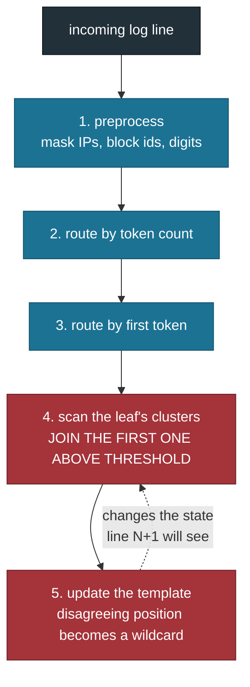
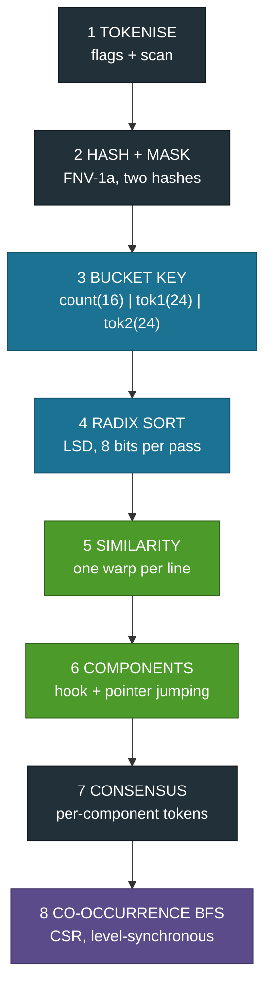
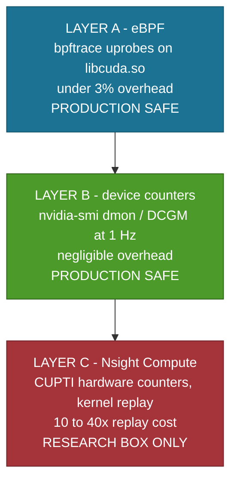

# TriParseGPU

**GPU-native log template mining for large-scale system logs.**

The first GPU implementation of log template mining. We reformulated Drain, the
standard log parsing algorithm, so it is order-independent, implemented it as
eight GPU stages with seven hand-written CUDA kernels, and measured 23.7 to
65.5 million lines per second against a CPU reference that does 8,475 to 79,919.

**IIT Jodhpur · M.Tech (AI) · GPU Programming · Prof. Binod Kumar**

---

## The team

| Member | Roll number | Owns |
|---|---|---|
| **Jeenal Chaudhary** | G25AIT2027 | Similarity kernel, connected components, template consensus |
| **Rohit Patel** | G25AIT2089 | Tokenisation, hashing, bucket key, GPU I/O, profiling, paper |
| **Kosuru Yuvaraj** | G25AIT2054 | Radix sort, Blelloch scan, co-occurrence graph and BFS |
| **Sharvan Vittala** | G25AIT2099 | Accuracy metrics, test suite, benchmark harness, figures |

We split the work by pipeline stage so each of us owns our kernels end to end:
the CUDA source, the Python wrapper, the tests against a CPU reference, and the
numbers in the results table.

<details>
<summary><b>Who built what, in detail</b></summary>

**Rohit Patel (G25AIT2089)** - stages 1 to 4 and the measurement stack
- `kernels/split.cu`, `kernels/hash.cu`: newline marking, header stripping,
  FNV-1a token hashing, wildcard classification
- `triparsegpu/io.py`, `gpuio.py`, `tokenize.py`, `hashing.py`, `bucket.py`
- The two-hash design, which took OpenStack from 15,791 templates to 47 and
  grouping accuracy from 0.7325 to 0.8070, above the CPU reference
- On-device file reading with pinned memory: 13.2 GB/s transfer, 10.9 M lines/s
  from disk
- The three-layer profiling stack (Nsight Compute, eBPF, DCGM) including
  `scripts/profile.sh`, `scripts/ncu_summary.py`, `scripts/ebpf/`
- The bottleneck diagnosis and the paper draft

**Jeenal Chaudhary (G25AIT2027)** - stages 5 to 7, the core of the reformulation
- `kernels/similarity.cu`: one warp per line, 32 lanes over 32 token positions,
  shuffle reduction with no shared memory
- `kernels/ccl.cu`: connected components by hook and pointer jumping, with a
  four-byte convergence flag instead of a full label-array readback
- `kernels/template.cu`: per-component token consensus. Rewriting the thread
  mapping from one block per component to one thread per (line, token) pair
  took this from 113 ms to 1.1 ms
- `triparsegpu/cluster.py`, `template.py`
- Validation against `scipy.sparse.csgraph`

**Kosuru Yuvaraj (G25AIT2054)** - the Problem 7 primitives and graph traversal
- `kernels/radix.cu`: LSD radix sort, stable with duplicates, 8 bits per pass.
  Replacing the serial digit-ranking loop with a warp ballot took the sort from
  7.77 ms to 5.22 ms on 11.2 M keys
- `kernels/scan.cu`: Blelloch work-efficient scan. Reaches parity with CuPy at
  100 M elements (2.19 ms against 2.18 ms)
- `kernels/cooccur.cu`: co-occurrence graph in CSR plus level-synchronous BFS
- `triparsegpu/radix.py`, `scan.py`, `graph.py`
- The hand-written versus library comparison against CUB

**Sharvan Vittala (G25AIT2099)** - correctness and evidence
- `triparsegpu/metrics.py`: GA, PA, FGA and ARI
- `triparsegpu/ref_drain3.py`: the Drain3 baseline using the official logparser
  benchmark settings, reproducing the published numbers exactly. Without this
  no speed claim would mean anything
- `tests/`: 84 tests, every stage checked against a CPU reference
- `bench/parsebench.py`, `bench/run_all.sh`, `triparsegpu/timing.py`: locked
  clocks, warm-up at full input size, median of five, three reported columns
- `model/stages.py`: the five figures, generated from the result JSONs

</details>

---

## 1. The problem

Every system writes logs. Before anything can be done with them, each raw line
must be reduced to a **template** plus its **parameters**:

```
connected to 10.0.0.7 port 22   ->   connected to <*> port <*>
connected to 10.0.0.9 port 22        parameters: 10.0.0.7, 10.0.0.9
```

This is **log template mining**, and it is the first stage of every log pipeline
in production. Anomaly detection, correlation and log-reading language models
all consume templates, never raw text.

The compression is the point:

| Dataset | Lines | Distinct templates |
|---|---|---|
| HDFS | 11,175,629 | 51 |
| BGL | 4,747,963 | 206 |
| Thunderbird | 2,000,000 | 1,183 |
| OpenStack | 137,074 | 47 |

### Why it is a bottleneck

The standard algorithm is **Drain** (He et al., ICWS 2017). Drain3 (IBM's
Python implementation), the Go port and the C# port are all single-threaded CPU
code. Measured by us on the same machine:

| Dataset | Drain3 lines/s | Templates |
|---|---|---|
| Thunderbird | 8,475 | 1,183 |
| OpenStack | 31,795 | 47 |
| BGL | 45,418 | 206 |
| HDFS | 79,919 | 51 |

At 80,000 lines per second, **one billion lines takes 3 hours 28 minutes on a
single core**, before any analysis begins. Production systems emit billions per
day.

---

## 2. The gap we found

| Work | Year | What it does | Hardware |
|---|---|---|---|
| Drain | 2017 | Fixed-depth parse tree plus similarity | CPU, 1 thread |
| Drain3, Go and C# ports | current | Same algorithm, faster language | CPU, 1 thread |
| Spell | 2016 | Longest common subsequence | CPU |
| LILAC | 2024 | LLM with an adaptive parsing cache | GPU for the LLM only |
| RAPIDS log work | 2019 | Regular-expression filtering of logs | GPU, different problem |

**No GPU implementation of template mining itself existed.** The closest prior
GPU work accelerates regex filtering, which is a different problem. LILAC uses a
GPU only to run a language model.

Why the gap survived nine years:

1. **Drain is sequential by construction** (see below).
2. GPU researchers do not work on logs.
3. Log researchers do not write CUDA.

---

## 3. Why Drain cannot be parallelised as written



Steps 4 and 5 are the problem. **First match wins** means line N depends on the
clusters built from lines 1 to N-1. A GPU needs thousands of independent work
items; Drain hands it a chain.

### The three observations that unlocked it

1. The parse tree is only a lookup on `(token count, first token)`. That is a
   **sort key**, not a tree.
2. Similarity is **positional token equality**. No edit distance, no sequence
   alignment, so it parallelises trivially.
3. **First match wins is the only sequential step.**

---

## 4. Our solution: Batch-Drain

Replace the sequential cluster assignment with a graph problem.


### Why a bounded window is not an approximation

**Transitive closure covers the gaps.** If A is similar to B and B is similar to
C, connected components puts A, B and C in one cluster even though A and C were
never compared.

Measured on BGL: grouping accuracy is **identical at w=16 and w=128**, while the
edge count grows fivefold.

| window | GA (BGL) | edges |
|---|---|---|
| 4 | 0.9540 | 7,136 |
| 8 | 0.9580 | 13,587 |
| **16** | **0.9685** | **25,382** |
| 32 | 0.9685 | 45,914 |
| 64 | 0.9685 | 79,509 |
| 128 | 0.9685 | 129,598 |

We have strong empirical evidence and a proof sketch, not a formal proof. This
is the weakest point in the work and we state it rather than hide it.

### Order-independence, verified

| Dataset | ARI vs Drain3 |
|---|---|
| BGL | 1.0000 |
| HDFS | 1.0000 |
| Thunderbird | 0.9999 |
| OpenStack | 0.9777 |

Three datasets show **exact agreement**, so the reformulation is not an
approximation. OpenStack diverges toward the truth: our GA there is 0.8070
against Drain3's 0.7325, so where we disagree it is the sequential method that
is wrong.

### The design point that mattered most

Preprocessing masks parameters inside tokens, producing literals such as
`blk_<*>`. Those are still literal text and must appear in the template, but
using them in the bucket key gives every partially-masked UUID its own cluster.

The fix is **two hashes**:

```c
out_wild[t]  = wild ? 1 : 0;
out_hash[t]  = wild ? 0ULL : h;                    // similarity + template text
// bucket hash: a token that merely CONTAINS a wildcard marker
// (blk_<*>, <*>f<*>bdd) must not split buckets, or every UUID
// becomes its own bucket.
out_bhash[t] = (wild || has_marker) ? 0ULL : h;
```

| OpenStack (full dataset) | Before | After |
|---|---|---|
| Templates | 15,791 | **47** |
| Singletons | 6,679 | **3** |
| Grouping accuracy | 0.7325 | **0.8070** |

This sidesteps a structural weakness in Drain's own first-token routing, which
is why an order-independent method can beat the sequential original.

---

## 5. How we tackled it: eight stages, seven hand-written kernels



Blue is Problem 7, green is Problem 3, violet is Problem 2, grey is supporting.

**The invariant:** nothing returns to the host between stages except a single
four-byte convergence flag per labelling round.

### The three course problems, and the depth of each

| Problem | What the statement asked for | What we delivered |
|---|---|---|
| **P7** | parallel prefix scan | Blelloch scan plus an LSD radix sort built on it, over a packed 64-bit key, replacing Drain's parse tree entirely |
| **P3** | connected-component labelling | iterative hook and pointer jumping to convergence on a 16 M-edge similarity graph, with a four-byte convergence test instead of a label-array readback |
| **P2** | BFS on a graph | the co-occurrence graph is **built on-device** in CSR from parser output, then traversed level-synchronously |

We used three of the eight problems rather than listing all eight shallowly.
Full reasoning in `docs/PROBLEM_MAPPING.md`.

### Three tiers, and why all three exist

| Tier | What | Why it exists | Throughput |
|---|---|---|---|
| 0 | Drain3 CPU | ground-truth clusters and the baseline every speedup divides by | 8k to 80k lines/s |
| 1 | CuPy library primitives | proves the formulation works before any hand-written kernel | 23.8 to 66.5 M/s |
| 2 | hand-written CUDA | the course deliverable and the Problem 7 answer | 23.7 to 65.5 M/s |

Tiers 1 and 2 give **identical accuracy** on all four datasets. That is how we
know the hand-written kernels are correct, not merely fast.

### The optimisations that mattered

| Change | Before | After | Why |
|---|---|---|---|
| Consensus thread mapping | 113 ms | 1.1 ms | 36 components on 188 SMs left the device 80% idle. One thread per (line, token) pair instead of one block per component. |
| Pinned host memory | 1.2 GB/s | 13.2 GB/s | DMA from page-locked memory. One line of code. |
| Warp-ballot radix ranking | 7.77 ms | 5.22 ms | A serial loop over 256 earlier threads became one ballot instruction. |
| Bucket hash separation | GA 0.7325 | GA 0.8070 | See section 4. |

Thread mapping beat algorithm tuning. The 100x came from changing how work was
assigned, not from a better algorithm.

---

## 6. Results

All numbers below are reproducible with the commands in section 8. Clocks
locked at 2,626 MHz, warm-up at full input size, median of five runs.

### Accuracy (LogHub-2k, tier 2, window 16)

| Dataset | GA | PA | FGA | ARI vs Drain3 | Drain3 GA |
|---|---|---|---|---|---|
| BGL | 0.9685 | 0.8115 | 0.8444 | 1.0000 | 0.9625 |
| HDFS | 0.9975 | 0.8085 | 0.8667 | 1.0000 | 0.9975 |
| Thunderbird | 0.9425 | 0.1770 | 0.7045 | 0.9999 | 0.9550 |
| OpenStack | **0.8070** | 0.0720 | 0.6933 | 0.9777 | 0.7325 |

At or above the CPU reference on three of four datasets.

PA is low where the ground truth masks inside tokens. Published Drain PA on
these datasets is similarly low; we report it rather than omit it.

### Throughput (full datasets, tier 2)

| Dataset | Lines | Drain3 CPU | GPU kernels | GPU +H2D | Speedup | Tier-1 kernels |
|---|---|---|---|---|---|---|
| OpenStack | 137,074 | 31,795/s | 26.3 M/s | 22.1 M/s | 826x | 28.4 M/s |
| BGL | 4,747,963 | 45,418/s | 63.5 M/s | 50.8 M/s | 1,398x | 64.6 M/s |
| Thunderbird | 2,000,000 | 8,475/s | 23.7 M/s | 21.5 M/s | 2,791x | 23.8 M/s |
| HDFS | 11,175,629 | 79,919/s | 65.5 M/s | 49.2 M/s | 820x | 66.5 M/s |

The hand-written tier costs 1.5% to 7.4% against library primitives end to end.

### Three columns, reported together

A single headline number would be misleading, so we report all three
(HDFS, 1 M lines):

| Column | Rate | What it includes |
|---|---|---|
| Kernels only | 44 M lines/s | GPU kernel time alone |
| Plus H2D | 12.5 M lines/s | adds the host-to-device copy |
| End to end | 127 k lines/s | adds CPU file read and regex, and is dominated by them |

End to end is 2.4x over Drain3, not 230x. That is why we moved file reading onto
the GPU as well.

### Scaling (tier 2)

| Lines | BGL | HDFS |
|---|---|---|
| 100 k | 23.95 M/s | 23.58 M/s |
| 1 M | 46.41 M/s | 44.53 M/s |
| full | 63.50 M/s | 65.68 M/s |

Small inputs cannot fill 188 SMs. Throughput roughly triples from 100,000 lines
to full size, which is the regime production volumes sit in.

### Three findings we did not plan for

1. **Drain slows as templates accumulate.** BGL falls from 53,600 to 48,400
   lines/s within a single run as templates grow from 61 to 157. Thunderbird
   runs at 8,475 with 1,183 templates. Drain scans the cluster list at each
   leaf; we sort, so we have no such slope. Our advantage grows exactly where
   logs are hardest.
2. **Window 16 equals window 128** on accuracy, with five times fewer edges.
3. **Separating the bucket hash** turned 15,791 templates into 47 and pushed
   accuracy above the CPU reference.

All three came from measurement, not from design.

---

## 7. Profiling and observability

We built three layers rather than relying on Nsight alone, because Nsight is the
one tool that can never run on a production GPU.



**The rule we worked to:** start at the cheapest layer that can answer the
question, and escalate only when it cannot. We reached for Nsight exactly once,
after eBPF had already shown launch overhead was 13% of GPU time and therefore
not the problem.

### Which tool answers which question

| Question | Tool | Overhead | Production safe |
|---|---|---|---|
| Is the GPU busy at all? | `nvidia-smi dmon`, DCGM | about 0% | yes |
| Who else is on this card? | `nvidia-smi --query-compute-apps` | about 0% | yes |
| How many launches, how slow? | bpftrace uprobe on `libcuda.so` | under 3% | yes |
| Where are the gaps? | Nsight Systems (`nsys`) | 5 to 20% | with care |
| Why is this kernel slow? | Nsight Compute (`ncu`) | 10 to 40x replay | **no** |
| How long did my stage take? | CUDA events in code | about 0% | yes |

### Building the toolchain

```bash
# Layer C: CUDA toolkit and Nsight
sudo apt-get install -y cuda-toolkit-13-2
sudo apt-get install -y nsight-compute-2026.3.1 nsight-systems-2026.3.1
echo 'export PATH=/usr/local/cuda-13.2/bin:$PATH' >> ~/.bashrc

# Layer A: eBPF
sudo apt-get install -y bpftrace bpfcc-tools linux-tools-common \
                        linux-tools-$(uname -r) libbpf-dev

# Layer B: device telemetry
sudo apt-get install -y datacenter-gpu-manager
sudo systemctl enable --now nvidia-dcgm
```

Verify each layer:

```bash
nvcc --version ; ncu --version ; nsys --version ; bpftrace --version
sudo bpftrace -l 'uprobe:*libcuda*' | head
nvidia-smi dmon -c 1 ; dcgmi discovery -l
```

<details>
<summary><b>Five setup traps we hit, and the fixes</b></summary>

| Symptom | Cause | Fix |
|---|---|---|
| `apt install nsight-compute` has no candidate | it is a virtual package | install an explicit version: `nsight-compute-2026.3.1` |
| `nvcc: command not found` after install | the toolkit never appends to PATH, so CuPy cannot compile a kernel at runtime | `export PATH=/usr/local/cuda-13.2/bin:$PATH` |
| `ERR_NVGPUCTRPERM` from ncu | hardware counters need elevated permission | `sudo env "PATH=$PATH" ncu ...` (preserve PATH or ncu will not find python) |
| ncu prints nothing | `--csv` and `-o` conflict | drop `-o`, redirect stdout |
| `CUPY_GPU_MEMORY_LIMIT` ValueError on `"40GB"` | it takes raw bytes | `CUPY_GPU_MEMORY_LIMIT=42949672960` |

</details>

### Per-kernel profile (BGL 1 M lines, tier 2, idle GPU)

```bash
sudo env "PATH=$PATH" bash scripts/profile.sh BGL 2 1000000 > results/ncu/bgl.csv
python scripts/ncu_summary.py results/ncu/bgl.csv
```

| Kernel | Total us | % of time | Mean SM % |
|---|---|---|---|
| similarity_edges | 8,300 | 75.3 | 14.7 |
| ccl_hook | 1,773 | 16.1 | 8.0 |
| consensus_reduce | 401 | 3.6 | 22.0 |
| block_scan | 160 | 1.5 | 19.7 |
| radix_scatter | 112 | 1.0 | 30.3 |
| radix_histogram | 95 | 0.9 | 22.0 |
| hash_tokens | 87 | 0.8 | 69.4 |
| add_offsets | 64 | 0.6 | 6.3 |
| ccl_compress | 23 | 0.2 | 9.4 |

11.0 ms over 54 launches. **Two kernels are 91% of the time.** Only
`hash_tokens` is anywhere near the hardware limit, and it is under 1% of the
time. We measured this twice, once with an unrelated process resident and once
on an idle GPU; the two agree within 0.3%.

### Diagnosing the bottleneck

The obvious explanation was wrong, and a designed experiment was needed to
separate the two hypotheses.

1. **Suspect.** `similarity_edges` is 75% of kernel time at 14.7% SM and 1.9% of
   peak DRAM, and issues 15.9 M atomic sectors against one global edge counter.
2. **Hypothesis.** Contention on that atomic is serialising the kernel.
3. **Design a test.** If it is contention, cost per edge rises with window size.
   If it is the writes, cost per edge stays flat.
4. **Measure.** Edges per millisecond at w = 1, 4, 16: **1,670 / 1,917 / 1,971.
   Flat.**
5. **Conclude.** Not atomics. Two scattered 8-byte stores per edge: 16 M x 16 B
   = 256 MB, against the 268 MB Nsight measured. The kernel is **latency-bound
   on uncoalesced writes.**

The remedy follows from the diagnosis: emit fewer edges, do not try to write
them faster. That is the first item in future work.

`ccl_hook` is bound differently: 460 GB/s with a long-scoreboard stall ratio of
120, which is the dependent-load pointer chase in root finding.

### Two negative results we are reporting

- **eBPF cannot see a statically linked runtime.** 167 probes on memory transfer
  and synchronisation attached and never fired. CuPy's wheel links the CUDA
  runtime statically, so there is no `libcudart.so` in the process map to probe.
  Kernel launches are visible only because they funnel through the driver
  library. 314 launches, median about 5 us, 2.83 ms total or 13% of GPU time.
- **1 Hz sampling has a resolution floor.** Six of sixty-two DCGM samples
  recorded any activity, and those that did ranged from 10% to 99% SM
  utilisation. The pipeline does about 75 ms of GPU work per invocation, so most
  samples land between launches.

Both apply to anyone profiling a Python GPU service, which is most of AI
infrastructure today.

### Profiling assets in this repo

| Path | What it does |
|---|---|
| `scripts/lock_clocks.sh` | persistence mode on, clocks pinned to 2,626 MHz |
| `scripts/profile.sh` | one command: ncu counters then nsys timeline |
| `scripts/ncu_summary.py` | per-kernel table with units normalised correctly |
| `scripts/ebpf/cuda_launch_latency.bt` | uprobe and uretprobe on `cuLaunchKernel` |
| `scripts/ebpf/cuda_sync_stalls.bt` | synchronisation probes, the documented negative result |
| `results/ncu`, `results/ebpf`, `results/dcgm` | every capture, each with a README |

> Nsight auto-scales units **per row**: one row is in ns, the next in us or ms.
> Summing the raw `Metric Value` column mixes scales and silently produces
> percentages that are wrong by a factor of a thousand. We nearly published such
> a number and caught it with a second independent capture. Always normalise via
> the `Metric Unit` column, which is what `scripts/ncu_summary.py` does.

---

## 8. Install, use, reproduce

### Install

```bash
python3 -m venv .venv && source .venv/bin/activate
pip install -e .
pip install cupy-cuda13x numpy pandas matplotlib pyyaml pytest drain3 regex scikit-learn scipy
```

Requires CUDA 13.x and a GPU of compute capability 12.0. Set `ARCH` in
`triparsegpu/compile.py` for other architectures.

### Use

```python
from triparsegpu import io, pipeline

contents, _ = io.load_contents("path/to/HDFS.log", "HDFS")
contents = io.preprocess(contents, "HDFS")
ids, templates, timings, meta = pipeline.parse(contents, st=0.4, depth_tokens=2)
```

### Reproduce every number above

```bash
bash scripts/lock_clocks.sh          # required for stable numbers
export TRIPARSE_CLOCKS_LOCKED=1

# one dataset, tier 2 (dataset names are case sensitive)
python bench/parsebench.py --dataset BGL --tier 2 --limit 1000000 \
  --window 16 --reps 5 --warmup 1 --out results/bgl_1m.json

# full sweep: tier comparison, scaling curve, window sensitivity
bash bench/run_all.sh

# the five figures, from the result JSONs
python model/stages.py
```

> **Warm up at full input size.** Our first measurements were 25x too slow
> because the first allocation of a 1.6 GB buffer costs 380 ms of driver time.

### Tests

```bash
pytest -q          # 84 passed
```

Every stage is checked against a CPU reference:

| Stage | Reference |
|---|---|
| tokenise | Python `str.split` |
| sort | NumPy stable `argsort` |
| scan | NumPy `cumsum` |
| components | `scipy.sparse.csgraph.connected_components` |
| BFS | `scipy.sparse.csgraph.shortest_path` |
| end to end | Drain3 clustering, compared by ARI |

---

## 9. Pipeline reference

1. `io` / `gpuio`: header strip and parameter regexes. `gpuio` does newline
   marking and header stripping on-device from pinned host memory
   (13.2 GB/s H2D, 10.9 M lines/s end to end from disk) *(CUDA)*
2. `tokenize`: token boundaries via flags and scan
3. `hashing`: FNV-1a per token, wildcard classification, separate bucket hash *(CUDA)*
4. `bucket`: 64-bit bucket key, radix sort, segment boundaries *(CUDA)*
5. `cluster.similarity_edges`: warp-per-line similarity inside a bucket *(CUDA)*
6. `cluster.ccl`: connected components, hook and pointer jumping *(CUDA)*
7. `template.consensus`: per-component token consensus *(CUDA)*
8. `graph`: template co-occurrence graph in CSR plus level-synchronous BFS *(CUDA)*

Mnemonic: **"THe BaSiC TeaM Goes"** - Tokenise, Hash, Bucket, Sort, Compare,
Tie together, Merge, Graph.

---

## 10. Repository layout

```
triparsegpu/
  kernels/        9 CUDA sources, compiled at runtime via CuPy RawModule
  triparsegpu/    15 Python modules, the harness
  bench/          parsebench.py, run_all.sh, datasets.yaml
  tests/          84 tests, every stage against a CPU reference
  scripts/        lock_clocks, profile, ncu_summary, ebpf/
  model/          stages.py, generates the five figures
  results/        every result JSON, ncu CSV, eBPF and DCGM capture
  figures/        fig1 to fig5
  docs/           see below
```

Kernels are plain `.cu` text files. Python compiles them with nvcc through CuPy
`RawModule` at import time and launches them directly. No C++ host code, no
build step, no bindings to regenerate.

---

## 11. Documentation

| File | What it covers |
|---|---|
| `docs/README.md` | Documentation index |
| `docs/PROJECT_STORY.md` | Why we chose this problem, the gap, and how we built it |
| `docs/MASTER_GUIDE.md` | Concepts, mnemonics, cheatsheets, commands, open items |
| `docs/CODE_WALKTHROUGH.md` | Python harness and CUDA kernels, module by module |
| `docs/PROBLEM_MAPPING.md` | P7, P3 and P2, and why we chose those three |
| `docs/VIVA_CHEATSHEET.md` | Fast answers to likely questions |
| `docs/DESIGN.md` | Design rationale and kernel listings |
| `docs/RUNBOOK.md` | Step-by-step execution on the GPU box |
| `docs/TriParseGPU_HANDBOOK.md` | Team handbook, diagrams, cheatsheet |

---

## 12. Status and future work

**Complete.** Steps 1 to 10 of 11: setup, data, Drain3 baseline, tier-1
pipeline, tier-2 kernels, accuracy gate, benchmark sweep, profiling, figures and
documentation. Step 11, the course report and the paper, is the remaining work.

Every item below came from a measurement, not a wish list.

| Priority | Item | Why |
|---|---|---|
| High | Two-pass clustering | `similarity_edges` is 75% of kernel time and latency-bound on scattered writes. Comparing component representatives in a second pass emits far fewer edges. Largest available win. |
| High | Course report and paper | Overleaf sections drafted, prose outstanding |
| Medium | Replace `cp.bincount` and `cp.searchsorted` in `tokenize.py` | the last two library calls in tier 2, or state the scope explicitly |
| Medium | Streaming mode | the full 211 M-line Thunderbird set exceeds device memory |
| Medium | LogHub-2.0, plus Spell and LILAC as baselines | larger annotated sets, more comparison parsers |
| Low | Single-pass decoupled-lookback scan | our Blelloch scan reaches 41% of peak bandwidth across three kernels |
| Low | Multi-item-per-thread radix sort | closes the known 2.4x gap to CUB |
| Open | A formal proof of window plus closure equivalence | currently empirical only; reviewers will ask |

---

## 13. Environment

| | |
|---|---|
| GPU | NVIDIA RTX PRO 6000 Blackwell Max-Q Workstation Edition, 96 GB |
| Compute capability | 12.0 (`sm_120`) |
| CUDA | 13.2, driver 595.58.03 |
| Harness | Python 3.12, CuPy, NumPy, pandas, pytest |
| Reference | Drain3, scipy, scikit-learn |
| Profiling | Nsight Compute and Systems, bpftrace and BCC, NVIDIA DCGM |

---

## License

Apache-2.0
