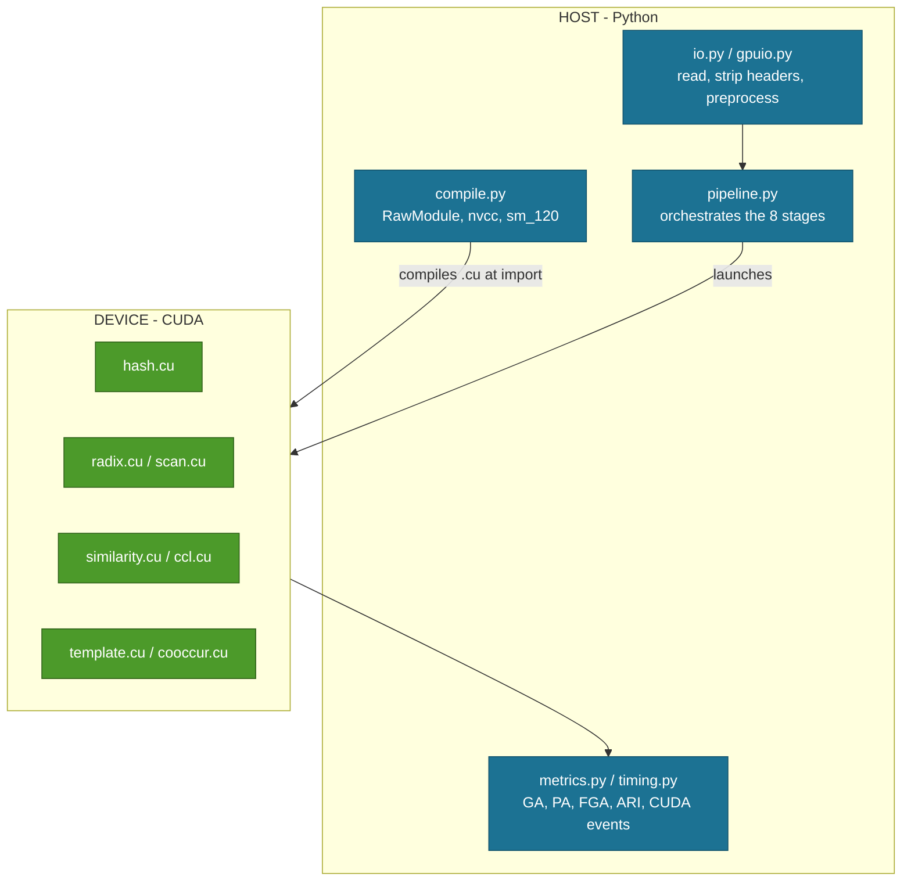

# TriParseGPU - Code Walkthrough

How the Python harness and the CUDA kernels fit together, module by module and
kernel by kernel. Read this before changing anything.

---

## The architecture in one picture



**The design rule:** kernels are plain `.cu` text files. Python compiles them
with nvcc through CuPy `RawModule` at import time and launches them directly.
No C++ host code, no build step, no bindings to regenerate.

Change a kernel, rerun, done.

---

## Part 1 - The Python harness

### `compile.py` - the bridge

Everything starts here. It reads each `.cu` file and hands it to CuPy.

```python
import cupy as cp
from pathlib import Path

ARCH = "sm_120"              # RTX PRO 6000 Blackwell, compute capability 12.0
KERNEL_DIR = Path(__file__).parent.parent / "kernels"

_cache = {}

def load(name: str) -> cp.RawModule:
    """Compile kernels/<name>.cu once, cache the module."""
    if name in _cache:
        return _cache[name]
    src = (KERNEL_DIR / f"{name}.cu").read_text()
    mod = cp.RawModule(
        code=src,
        backend="nvcc",                      # not nvrtc - we need <cub> and C++17
        options=(f"-arch={ARCH}", "-std=c++17", "-lineinfo"),
        name_expressions=None,
    )
    _cache[name] = mod
    return mod

def kernel(module: str, fn: str):
    return load(module).get_function(fn)
```

**Why `nvcc` and not `nvrtc`:** nvrtc cannot see headers we include, and nvcc
gives better diagnostics. The cost is a one-off compile at import (~2 s).

**Why `-lineinfo`:** Nsight Compute can then attribute stalls to source lines.

**If you port this to another GPU:** change `ARCH`. That is the only place the
architecture appears.

---

### `pipeline.py` - the orchestrator

The only module that knows the whole sequence. Roughly:

```python
def parse(contents, st=0.4, depth_tokens=2, window=16, tier=2):
    # stage 1-2: tokenise and hash
    tok_ids, tok_off, n_tok = tokenize.tokenize_gpu(contents)
    h, bh, wild      = hashing.hash_tokens(tok_ids, tok_off)

    # stage 3-4: bucket key, sort, segment boundaries
    keys             = bucket.make_keys(tok_off, h, bh, depth_tokens)
    order            = radix.sort(keys) if tier == 2 else cp.argsort(keys)
    seg_start        = bucket.segments(keys[order])

    # stage 5-6: similarity graph, connected components
    src, dst, n_edge = cluster.similarity_edges(order, seg_start, h, wild,
                                                tok_off, st, window)
    labels           = cluster.ccl(src, dst, n_edge, n_lines)

    # stage 7: template consensus
    templates        = template.consensus(labels, tok_ids, tok_off, h, wild)

    # stage 8: co-occurrence graph + BFS
    graph_csr        = graph.cooccurrence(labels, window)

    return labels, templates, timings, meta
```

**The invariant to preserve:** nothing returns to the host between stages
except the four-byte convergence flag inside `ccl`. If you add a `.get()` or a
`int(...)` on a device array mid-pipeline, you have just added a sync point and
the throughput will drop. Check `timing.py` output after any change.

---

### Module reference

| Module | Responsibility | Notes |
|---|---|---|
| `io.py` | Load a log file, strip headers per the logparser `log_format`, apply per-dataset parameter regexes | CPU path, used for the accuracy runs |
| `gpuio.py` | The same, on-device: newline marking, header strip, pinned-memory transfer | 10.9 M lines/s from disk |
| `tokenize.py` | Token boundaries from delimiter flags + scan | Still uses `cp.bincount` / `cp.searchsorted` - see open items |
| `hashing.py` | Launch `hash_tokens`; returns text hash, bucket hash, wildcard flags | The two-hash split lives here |
| `bucket.py` | Pack the 64-bit key, find segment boundaries | |
| `radix.py` | LSD radix sort (tier 2) | `cp.argsort` is the tier-1 path |
| `scan.py` | Blelloch exclusive scan (tier 2) | `cp.cumsum` is the tier-1 path |
| `cluster.py` | Similarity edges, connected components | The two heaviest kernels |
| `template.py` | Per-component token consensus into template strings | Keeps punctuation and literal prefixes |
| `graph.py` | Co-occurrence graph in CSR, level-synchronous BFS | |
| `pipeline.py` | Orchestration, timing, tier switch | |
| `ref_drain3.py` | The Drain3 baseline with the official benchmark settings | Reproduces published numbers exactly |
| `metrics.py` | GA, PA, FGA, ARI | |
| `timing.py` | CUDA event timers, the three reported columns | Refuses to claim locked clocks unless `TRIPARSE_CLOCKS_LOCKED=1` |

---

### The tier switch

Every tier-2 primitive has a tier-1 twin with an identical signature:

| Stage | Tier 1 (library) | Tier 2 (ours) |
|---|---|---|
| sort | `cp.argsort` | `radix.sort` |
| scan | `cp.cumsum` | `scan.exclusive` |
| everything else | hand-written | hand-written |

That is why **tiers 1 and 2 give identical accuracy** - only the primitive
changes, never the logic. If they ever diverge, the hand-written primitive has
a bug.

---

## Part 2 - The CUDA kernels

Nine files in `kernels/`.

| File | Kernels | Stage |
|---|---|---|
| `common.cuh` | shared device helpers, FNV-1a, warp reduce | - |
| `hash.cu` | `hash_tokens` | 2 |
| `scan.cu` | `block_scan`, `add_offsets` | 4, 8 |
| `radix.cu` | `radix_histogram`, `radix_scatter` | 4 |
| `split.cu` | `mark_newlines`, `content_start`, `compact_indices` | 1 |
| `similarity.cu` | `similarity_edges` | 5 |
| `ccl.cu` | `ccl_init`, `ccl_hook`, `ccl_compress` | 6 |
| `template.cu` | `consensus_init`, `consensus_reduce` | 7 |
| `cooccur.cu` | co-occurrence counting, BFS level step | 8 |

---

### `hash.cu` - the most important three lines in the project

```c
// one thread per token
__global__ void hash_tokens(const char* data, const int* tok_off, int n_tok,
                            unsigned long long* out_hash,
                            unsigned long long* out_bhash,
                            unsigned char* out_wild)
{
    int t = blockIdx.x * blockDim.x + threadIdx.x;
    if (t >= n_tok) return;

    int b = tok_off[t], e = tok_off[t + 1];

    unsigned long long h = 1469598103934665603ULL;   // FNV-1a offset basis
    bool all_digit = true, has_marker = false;
    for (int i = b; i < e; ++i) {
        char c = data[i];
        h = (h ^ (unsigned char)c) * 1099511628211ULL;
        if (c < '0' || c > '9') all_digit = false;
        if (c == '<' || c == '*') has_marker = true;   // part of "<*>"
    }

    bool wild = all_digit || is_ipv4(data, b, e) || is_hex_prefixed(data, b, e)
             || mostly_digits(data, b, e);

    out_wild[t]  = wild ? 1 : 0;
    out_hash[t]  = wild ? 0ULL : h;                    // similarity + template text
    // bucket hash: a token that merely CONTAINS a wildcard marker
    // (blk_<*>, <*>f<*>bdd) must not split buckets, or every UUID
    // becomes its own bucket.
    out_bhash[t] = (wild || has_marker) ? 0ULL : h;
}
```

**Read that last line carefully.** It is the difference between 15,791
templates and 47 on OpenStack, and between GA 0.7325 and 0.8070.

- `out_hash` keeps the literal text so `blk_<*>` prints correctly in the
  template.
- `out_bhash` zeroes any marker-containing token so it cannot split a bucket.

---

### `scan.cu` - Blelloch, three kernels

```c
// up-sweep then down-sweep within a block; block totals scanned separately
__global__ void block_scan(const unsigned int* in, unsigned int* out,
                           unsigned int* block_sums, int n)
{
    extern __shared__ unsigned int s[];
    int tid = threadIdx.x;
    int gid = blockIdx.x * blockDim.x * 2 + tid;

    s[tid]              = (gid              < n) ? in[gid]              : 0u;
    s[tid + blockDim.x] = (gid + blockDim.x < n) ? in[gid + blockDim.x] : 0u;
    __syncthreads();

    // up-sweep (reduce)
    for (int d = blockDim.x; d > 0; d >>= 1) {
        __syncthreads();
        if (tid < d) {
            int ai = offsetIdx(tid, d, 0), bi = offsetIdx(tid, d, 1);
            s[bi] += s[ai];
        }
    }

    if (tid == 0) { block_sums[blockIdx.x] = s[2 * blockDim.x - 1];
                    s[2 * blockDim.x - 1] = 0u; }

    // down-sweep (distribute)
    for (int d = 1; d <= blockDim.x; d <<= 1) {
        __syncthreads();
        if (tid < d) {
            int ai = offsetIdx(tid, d, 0), bi = offsetIdx(tid, d, 1);
            unsigned int t = s[ai]; s[ai] = s[bi]; s[bi] += t;
        }
    }
    __syncthreads();
    // write back ...
}
```

Then `add_offsets` folds the scanned block totals back in.

**Performance:** 2.19 ms at 100 M elements, 732 of ~1,790 GB/s = 41% of peak.
CuPy's `cumsum` is 2.18 ms. The remaining headroom is a single-pass
decoupled-lookback version, which would remove one full read and write.

---

### `radix.cu` - and the warp-ballot fix

The scatter must rank equal digits to stay stable. The naive version:

```c
// SLOW - serial loop over all earlier threads in the block
int rank = 0;
for (int i = 0; i < threadIdx.x; ++i)
    if (digit_of[i] == my_digit) ++rank;
```

The fix:

```c
// FAST - one instruction identifies every lane sharing my digit
unsigned int peers = __match_any_sync(0xFFFFFFFFu, my_digit);
int lane      = threadIdx.x & 31;
int rank_in_w = __popc(peers & ((1u << lane) - 1u));   // how many before me
int leader    = __ffs(peers) - 1;
```

**7.77 ms -> 5.22 ms** on 11.2 M keys. Scatter per pass went 0.68 -> 0.36 ms.

> **Bug we hit:** the sort failed above 262,144 keys because the multi-chunk
> scatter loop was strided. Fixed by giving each block one contiguous tile.
> `tests/test_radix.py` covers sizes either side of that boundary.

---

### `similarity.cu` - one warp per line

```c
__global__ void similarity_edges(const int* order, const int* seg_start,
                                 const unsigned long long* hash,
                                 const unsigned char* wild,
                                 const int* tok_off,
                                 float st, int window,
                                 int* edge_src, int* edge_dst,
                                 unsigned int* edge_count, int max_edges)
{
    int warp_id = (blockIdx.x * blockDim.x + threadIdx.x) >> 5;
    int lane    = threadIdx.x & 31;
    if (warp_id >= n_lines) return;

    int me  = order[warp_id];
    int beg = tok_off[me], n = tok_off[me + 1] - beg;

    for (int back = 1; back <= window; ++back) {
        int j = warp_id - back;
        if (j < seg_start[warp_id]) break;       // stay inside the segment
        int other = order[j];

        // each lane compares a different token position
        int match = 0;
        for (int p = lane; p < n; p += 32)
            match += (hash[beg + p] == hash[tok_off[other] + p]);

        // shuffle reduction - five steps, no shared memory
        for (int off = 16; off > 0; off >>= 1)
            match += __shfl_down_sync(0xFFFFFFFFu, match, off);

        if (lane == 0 && (float)match / (float)n >= st) {
            unsigned int e = atomicAdd(edge_count, 1u);
            if (e < max_edges) { edge_src[e] = me; edge_dst[e] = other; }
        }
    }
}
```

**This kernel is 75.3% of all GPU time** at only 14.7% SM throughput. The
diagnosis (latency-bound on two scattered 8-byte stores per edge, not atomic
contention) is in [PROJECT_STORY.md](PROJECT_STORY.md) section 10.

> **Optimisation that did NOT work:** we tried warp-aggregating the
> `atomicAdd`. It gained nothing and was reverted - only lane 0 ever evaluates
> the emit condition, so the ballot had nothing to aggregate. Worth knowing
> before you try it again.

---

### `ccl.cu` - hook, compress, converge

```c
__global__ void ccl_hook(const int* src, const int* dst, int n_edge,
                         int* label, int* changed)
{
    int e = blockIdx.x * blockDim.x + threadIdx.x;
    if (e >= n_edge) return;

    int u = src[e], v = dst[e];
    int ru = find_root(label, u), rv = find_root(label, v);
    if (ru == rv) return;

    int lo = min(ru, rv), hi = max(ru, rv);
    atomicMin(&label[hi], lo);
    *changed = 1;                       // benign race: everyone writes 1
}

__global__ void ccl_compress(int* label, int n)
{
    int i = blockIdx.x * blockDim.x + threadIdx.x;
    if (i < n) label[i] = find_root(label, i);     // pointer jumping
}
```

**Why the races are safe:** every writer of `changed` stores the same value, and
`atomicMin` is order-independent by definition. No locking needed.

**The convergence test is the point:** the host reads **one four-byte integer**
per round, not the label array. Two rounds on every real dataset.

---

### `template.cu` - the 100x thread-mapping lesson

Version 1 ran **one block per component**. On OpenStack that was 36 blocks on a
188-SM GPU: the device sat ~80% idle. **113 ms.**

Version 2 runs **one thread per (line, token) pair**, with an atomic marking
disagreement per position. **1.1 ms.**

The algorithm did not change. Only the mapping of work to threads did.

> If you learn one thing from this codebase, learn this one.

---

## Part 3 - Conventions to follow

### Launch configuration

```python
BLOCK = 256
grid  = (n + BLOCK - 1) // BLOCK
kern((grid,), (BLOCK,), (args...))
```

For warp-per-item kernels, one warp per item means `grid = (n*32 + BLOCK-1)//BLOCK`.

### Timing

Always CUDA events, never `time.time()` around a launch:

```python
from triparsegpu import timing
with timing.gpu_timer() as t:
    kern(...)
print(t.ms)
```

### Adding a kernel

1. Write `kernels/yours.cu`.
2. `fn = compile.kernel("yours", "your_kernel")`.
3. Add a test in `tests/` that checks it against NumPy or scipy.
4. Wire it into `pipeline.py` **behind the tier switch** if it replaces a
   library call.

### Testing philosophy

Every stage has a CPU reference:

| Stage | Reference |
|---|---|
| tokenise | Python `str.split` |
| sort | NumPy stable `argsort` |
| scan | NumPy `cumsum` |
| components | `scipy.sparse.csgraph.connected_components` |
| BFS | `scipy.sparse.csgraph.shortest_path` |
| end to end | Drain3 clustering, compared by ARI |

```bash
pytest -q                 # 84 passed in ~3 s
```

> **One test we fixed rather than the kernel:** `test_bfs_unreachable` failed
> because the *test data* still linked the two groups at window=1. The kernel
> was right. Check your fixture before you blame the kernel.

---

## Part 4 - Gotchas, collected

| Symptom | Cause | Fix |
|---|---|---|
| `nvcc: command not found` at import | toolkit installs without touching PATH | `export PATH=/usr/local/cuda-13.2/bin:$PATH` |
| `CUPY_GPU_MEMORY_LIMIT` ValueError | it takes raw bytes, not `"40GB"` | `CUPY_GPU_MEMORY_LIMIT=42949672960` |
| `ERR_NVGPUCTRPERM` from ncu | hardware counters need elevation | `sudo env "PATH=$PATH" ncu ...` |
| ncu prints nothing | `--csv` and `-o` conflict | drop `-o`, redirect stdout |
| First run 25x too slow | first 1.6 GB allocation costs 380 ms of driver time | warm up **at full input size** |
| Throughput collapsed after an edit | a `.get()` or `int()` added a sync point | check `timing.py` stage breakdown |
| Profile numbers off by 1000x | ncu auto-scales units per row | use `scripts/ncu_summary.py` |

---

## Open items in the code

| Priority | Item |
|---|---|
| Medium | `tokenize.py` still calls `cp.bincount` and `cp.searchsorted` - replace with kernels, or state the scope explicitly in the paper |
| Medium | Streaming mode: the full 211 M-line Thunderbird set exceeds device memory |
| Low | `scan.py`: single-pass decoupled-lookback version |
| Low | `radix.py`: multi-item-per-thread to close the CUB gap |
| High (from the profile) | `similarity.cu`: two-pass clustering that compares component representatives and emits far fewer edges |
