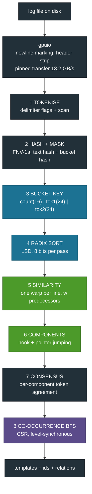
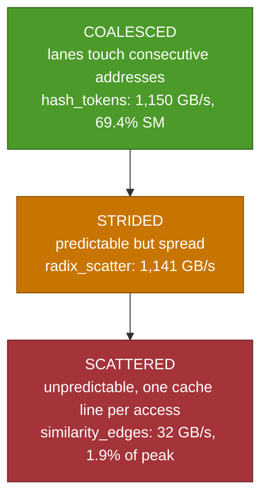
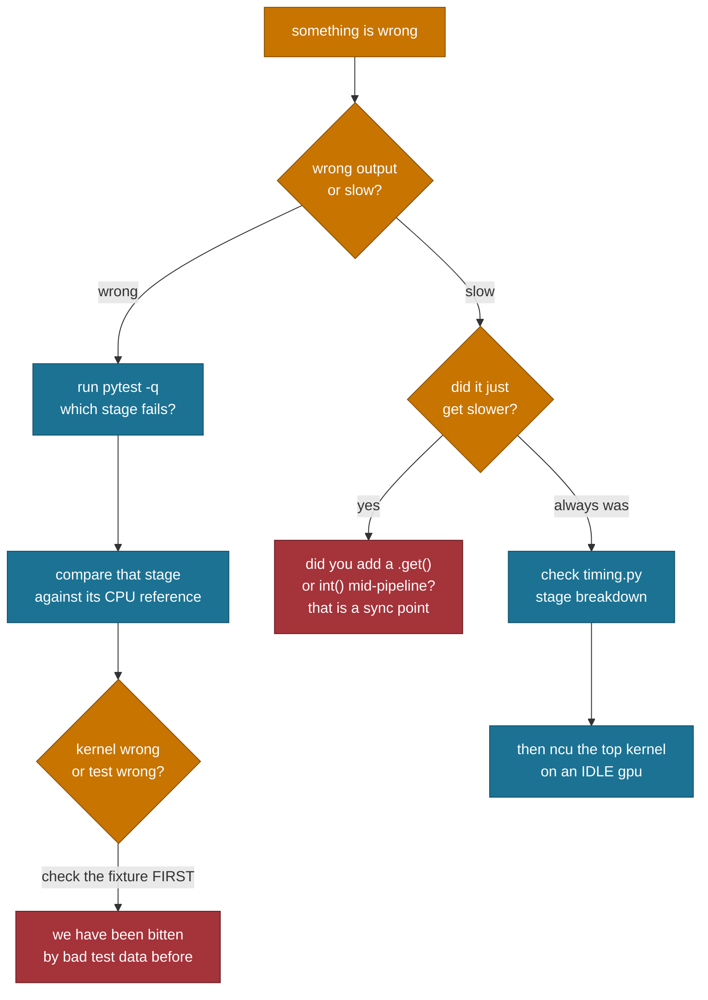

# TriParseGPU - Master Guide

Everything in one place: concepts, diagrams, mnemonics, cheatsheets, commands,
and the open items. If you read one document, read this one.

**IIT Jodhpur · M.Tech (AI) · GPU Programming · Prof. Binod Kumar**
Rohit Patel (G25AIT2089) · Jeenal Chaudhary (G25AIT2027) ·
Kosuru Yuvaraj (G25AIT2054) · Sharvan Vittala (G25AIT2099)

---

## Contents

1. [Core concepts you must hold](#1-core-concepts-you-must-hold)
2. [The system, end to end](#2-the-system-end-to-end)
3. [Mnemonics](#3-mnemonics)
4. [Stage-by-stage reference](#4-stage-by-stage-reference)
5. [GPU concepts cheatsheet](#5-gpu-concepts-cheatsheet)
6. [Numbers cheatsheet](#6-numbers-cheatsheet)
7. [Command cheatsheet](#7-command-cheatsheet)
8. [Profiling cheatsheet](#8-profiling-cheatsheet)
9. [Debugging playbook](#9-debugging-playbook)
10. [Who owns what](#10-who-owns-what)
11. [Open items](#11-open-items)

---

## 1. Core concepts you must hold

Six ideas. Everything else follows.

### 1.1 A log template

A log line minus its parameters.

```
connected to 10.0.0.7 port 22  ->  connected to <*> port <*>
```

Millions of lines collapse to tens or hundreds of patterns. That reduction is
what every downstream tool consumes.

### 1.2 Drain, and why it is sequential

Drain (He et al., ICWS 2017) routes a line down a fixed-depth tree on
`(token count, first token)`, then **joins the first cluster above a similarity
threshold**. That last step makes line N depend on lines 1..N-1.

### 1.3 Similarity here is positional equality

```
sim = matching token positions / token count
```

No edit distance. No sequence alignment. That is precisely why it parallelises.

### 1.4 Batch-Drain

Sort by bucket key -> compare each line to its `w` predecessors inside its
segment -> connected components of the resulting graph are the clusters.

### 1.5 Transitive closure covers the window

If A~B and B~C, then A, B and C are one cluster even though A and C were never
compared. This is why a bounded window is not an approximation.

### 1.6 Three tiers

| Tier | What | Why |
|---|---|---|
| 0 | Drain3 CPU | ground truth + baseline |
| 1 | CuPy primitives | proves the formulation |
| 2 | hand-written CUDA | the deliverable |

Tiers 1 and 2 give identical accuracy. That is the correctness proof for the
hand-written kernels.

---

## 2. The system, end to end



Blue = Problem 7 · Green = Problem 3 · Violet = Problem 2 · Grey = supporting

**The invariant:** nothing returns to the host between stages except one
four-byte convergence flag per labelling round.

---

## 3. Mnemonics

### The eight stages: **"THe BaSiC TeaM Goes"**

| Letter | Stage |
|---|---|
| **T** | **T**okenise |
| **H** | **H**ash |
| **B** | **B**ucket |
| **S** | **S**ort |
| **C** | **C**ompare (similarity) |
| **T** | **T**ie together (components) |
| **M** | **M**erge (consensus) |
| **G** | **G**raph (BFS) |

### The three problems: **7-3-2, Sort-Stick-Step**

- **7** = **Sort** (and scan)
- **3** = **Stick** things together (components)
- **2** = **Step** through the graph (BFS)

### The three profiling layers: **A-B-C, from the host inward**

- **A** = **A**lways-ish on, eBPF (host-side calls)
- **B** = **B**ackground telemetry, DCGM (device counters)
- **C** = **C**ostly deep dive, Nsight **C**ompute (per-kernel)

Reverse-alphabet by invasiveness: A cheapest, C heaviest.

### Benchmark discipline: **W-L-M-R**

- **W**arm up at full size
- **L**ock the clocks
- **M**edian of five
- **R**eport three columns

### The accuracy metrics: **"Great Parsers Find Agreement"**

- **G**A - grouping accuracy (right lines together?)
- **P**A - parsing accuracy (template string identical?)
- **F**GA - F1 over groups as sets
- **A**RI - agreement with the Drain3 reference

### Why we beat Drain on OpenStack: **"two hashes, one truth"**

One hash for text (so `blk_<*>` prints), one for bucketing (so UUIDs do not
split clusters).

---

## 4. Stage-by-stage reference

| # | Stage | Kernel(s) | Mapping | Cost | Key idea |
|---|---|---|---|---|---|
| 1 | Tokenise | `mark_newlines`, `compact_indices` | thread per byte | 10.6 ms / 1M lines | flags then scan |
| 2 | Hash + mask | `hash_tokens` | thread per token | 87 us, 69.4% SM | FNV-1a; **two hashes** |
| 3 | Bucket key | (arithmetic) | thread per line | - | pack 64 bits |
| 4 | Radix sort | `radix_histogram`, `radix_scatter`, `block_scan`, `add_offsets` | tile per block | 112+95+160+64 us | LSD, warp-ballot ranking |
| 5 | Similarity | `similarity_edges` | **warp per line** | 8,300 us (75.3%) | shuffle reduction, w predecessors |
| 6 | Components | `ccl_init`, `ccl_hook`, `ccl_compress` | thread per edge/node | 1,773+23 us (16.1%) | atomicMin, 4-byte convergence |
| 7 | Consensus | `consensus_init`, `consensus_reduce` | thread per (line, token) | 401 us | **113 ms -> 1.1 ms** by remapping |
| 8 | Co-occurrence BFS | `cooccur`, BFS level step | thread per node | - | CSR, one launch per level |

---

## 5. GPU concepts cheatsheet

Everything this project actually uses, in one table.

| Concept | What it is | Where we use it |
|---|---|---|
| **Warp** | 32 threads in lockstep | one warp per line in `similarity_edges` |
| **`__shfl_down_sync`** | lane reads another lane's register | 5-step reduction, no shared memory |
| **`__match_any_sync`** | which lanes share my value | radix digit ranking (the 7.77 -> 5.22 ms win) |
| **`__ballot_sync` / `__popc`** | bitmask of predicate + bit count | rank within a warp |
| **`atomicMin`** | order-independent minimum | component hooking - races are benign |
| **`atomicAdd`** | claim a slot | edge emission counter |
| **Coalescing** | consecutive lanes touching consecutive addresses | why scattered edge writes cost us 75% of runtime |
| **Occupancy** | resident warps / max warps | why 36 blocks on 188 SMs was a disaster |
| **Pinned memory** | page-locked host memory, DMA-able | 1.2 -> 13.2 GB/s |
| **Exclusive scan** | prefix sums, element i excluded | segment offsets, CSR row pointers, radix offsets |
| **Blelloch scan** | up-sweep reduce, down-sweep distribute | `scan.cu` |
| **Stream compaction** | keep only flagged elements | token boundaries, newline positions |
| **LSD radix sort** | histogram, scan, stable scatter, per digit | `radix.cu`, 8 bits x 8 passes |
| **CSR** | row pointers + column indices | co-occurrence graph |
| **Pointer jumping** | every node points straight at its root | `ccl_compress` |
| **Kernel replay** | profiler reruns a kernel to collect all counters | why Nsight is 10-40x and research-box only |
| **Long scoreboard stall** | warp waiting on a dependent load | `ccl_hook` ratio 120 - the root-finding chase |

### The three memory lessons



Card peak is ~1,790 GB/s. The gap between the top and bottom rows is the whole
optimisation story.

---

## 6. Numbers cheatsheet

### Accuracy (LogHub-2k, tier 2, window 16)

| Dataset | GA | PA | FGA | ARI | Drain3 GA |
|---|---|---|---|---|---|
| BGL | 0.9685 | 0.8115 | 0.8444 | 1.0000 | 0.9625 |
| HDFS | 0.9975 | 0.8085 | 0.8667 | 1.0000 | 0.9975 |
| Thunderbird | 0.9425 | 0.1770 | 0.7045 | 0.9999 | 0.9550 |
| OpenStack | **0.8070** | 0.0720 | 0.6933 | 0.9777 | 0.7325 |

### Throughput (full datasets, tier 2, locked clocks, median of 5)

| Dataset | Lines | Drain3 | Kernels | +H2D | Speedup |
|---|---|---|---|---|---|
| OpenStack | 137,074 | 31,795/s | 26.3 M/s | 22.1 M/s | 826x |
| BGL | 4,747,963 | 45,418/s | 63.5 M/s | 50.8 M/s | 1,398x |
| Thunderbird | 2,000,000 | 8,475/s | 23.7 M/s | 21.5 M/s | 2,791x |
| HDFS | 11,175,629 | 79,919/s | 65.5 M/s | 49.2 M/s | 820x |

### Scaling (tier 2)

| Lines | BGL | HDFS |
|---|---|---|
| 100 k | 23.95 M/s | 23.58 M/s |
| 1 M | 46.41 M/s | 44.53 M/s |
| full | 63.50 M/s | 65.68 M/s |

Small inputs cannot fill 188 SMs. Production volumes sit above saturation.

### Window sensitivity (HDFS 1M, tier 2)

| w | Throughput | GA |
|---|---|---|
| 4 | 65.5 M/s | 0.9540 |
| 8 | 56.7 M/s | 0.9580 |
| **16** | **44.4 M/s** | **0.9685** |
| 32 | 31.8 M/s | 0.9685 |
| 64 | 20.6 M/s | 0.9685 |

**w=16 is the knee.** Full accuracy at a third of w=64's cost.

### Per-kernel (BGL 1M, tier 2, idle GPU)

| Kernel | us | % | SM % |
|---|---|---|---|
| similarity_edges | 8,300 | 75.3 | 14.7 |
| ccl_hook | 1,773 | 16.1 | 8.0 |
| consensus_reduce | 401 | 3.6 | 22.0 |
| block_scan | 160 | 1.5 | 19.7 |
| radix_scatter | 112 | 1.0 | 30.3 |
| radix_histogram | 95 | 0.9 | 22.0 |
| hash_tokens | 87 | 0.8 | 69.4 |
| add_offsets | 64 | 0.6 | 6.3 |
| ccl_compress | 23 | 0.2 | 9.4 |

11.0 ms, 54 launches. Two kernels are 91% of the time.

### Primitives

| | Ours | Library |
|---|---|---|
| Scan, 100 M | 2.19 ms | CuPy 2.18 ms |
| Radix, 11.2 M keys | 5.22 ms | CUB 2.20 ms |

Tier-2 end-to-end penalty: Thunderbird 0.9%, BGL 1.6%, HDFS 1.6%, OpenStack 7.2%.

---

## 7. Command cheatsheet

```bash
# ---------- setup ----------
git clone git@github.com:rpaut03l/triparsegpu.git && cd triparsegpu
python3 -m venv .venv && source .venv/bin/activate
pip install -e .
pip install cupy-cuda13x numpy pandas matplotlib pyyaml pytest \
            drain3 regex scikit-learn scipy

# ---------- always before benchmarking ----------
bash scripts/lock_clocks.sh
export TRIPARSE_CLOCKS_LOCKED=1

# ---------- tests ----------
pytest -q                                   # 84 passed

# ---------- one benchmark ----------
python bench/parsebench.py --dataset BGL --tier 2 --limit 1000000 \
  --window 16 --reps 5 --warmup 1 --out results/bgl_1m.json
# NOTE: dataset names are case-sensitive: BGL, HDFS, OpenStack, Thunderbird

# ---------- the full sweep + figures ----------
bash bench/run_all.sh                       # ~12 min, 18 runs
python model/stages.py                      # fig1..fig5

# ---------- profiling ----------
sudo env "PATH=$PATH" bash scripts/profile.sh BGL 2 1000000 > results/ncu/bgl.csv
python scripts/ncu_summary.py results/ncu/bgl.csv
#                      ^^^^^^ profile.sh takes DATASET TIER LIMIT

sudo bpftrace scripts/ebpf/cuda_launch_latency.bt -p $(pgrep -f parsebench)
nvidia-smi dmon -s pucvmet -d 1 -o DT > results/dcgm/run.log &

# ---------- long runs ----------
screen -S work          # start
# Ctrl-A then D         # detach
screen -ls              # list
screen -r work          # reattach
screen -d -r work       # force-detach someone else's attachment
```

---

## 8. Profiling cheatsheet

### Which tool, when

| Question | Tool | Overhead | Prod-safe |
|---|---|---|---|
| Is the GPU busy at all? | `nvidia-smi dmon` / DCGM | ~0% | yes |
| Who else is on this card? | `nvidia-smi --query-compute-apps` | ~0% | yes |
| How many launches, how slow? | bpftrace uprobe on `libcuda.so` | <3% | yes |
| Where are the gaps? | Nsight Systems (`nsys`) | 5-20% | careful |
| Why is THIS kernel slow? | Nsight Compute (`ncu`) | 10-40x replay | **no** |
| How long did my stage take? | CUDA events in code | ~0% | yes |

**Rule:** start at the cheapest layer that can answer the question. Escalate
only when it cannot.

### Install

```bash
sudo apt-get install -y cuda-toolkit-13-2
sudo apt-get install -y nsight-compute-2026.3.1 nsight-systems-2026.3.1
echo 'export PATH=/usr/local/cuda-13.2/bin:$PATH' >> ~/.bashrc

sudo apt-get install -y bpftrace bpfcc-tools linux-tools-common \
                        linux-tools-$(uname -r) libbpf-dev

sudo apt-get install -y datacenter-gpu-manager
sudo systemctl enable --now nvidia-dcgm
```

### Verify

```bash
nvcc --version ; ncu --version ; nsys --version ; bpftrace --version
sudo bpftrace -l 'uprobe:*libcuda*' | head
nvidia-smi dmon -c 1 ; dcgmi discovery -l
```

### Setup traps

| Symptom | Fix |
|---|---|
| `nsight-compute` has no install candidate | it is a virtual package - use `nsight-compute-2026.3.1` |
| `nvcc: command not found` | `export PATH=/usr/local/cuda-13.2/bin:$PATH` |
| `ERR_NVGPUCTRPERM` | `sudo env "PATH=$PATH" ncu ...` |
| ncu prints nothing | `--csv` and `-o` conflict - redirect stdout |
| `CUPY_GPU_MEMORY_LIMIT` ValueError | raw bytes: `42949672960` |
| Profile numbers off by 1000x | ncu auto-scales units per row - use `scripts/ncu_summary.py` |

### The two negative results

- **eBPF cannot see a statically linked runtime.** 167 probes on memory
  transfer and synchronisation attached, none fired. CuPy's wheel links the
  CUDA runtime statically - no `libcudart.so` in the process map.
- **1 Hz sampling has a resolution floor.** 6 of 62 samples saw any activity,
  spread 10%-99%. The pipeline does ~75 ms of work per invocation.

---

## 9. Debugging playbook



### Checklist before you trust a number

1. Clocks locked? `TRIPARSE_CLOCKS_LOCKED=1` and `lock_clocks.sh` run.
2. Warmed up **at full input size**? The first 1.6 GB allocation costs 380 ms.
3. Median of five, not mean?
4. GPU actually idle? `nvidia-smi --query-compute-apps=pid,process_name --format=csv`
5. Cross-checked against a second capture?

---

## 10. Who owns what

| Member | Roll | Owns |
|---|---|---|
| Rohit Patel | G25AIT2089 | tokenise, hash, bucket, GPU I/O, profiling, paper lead |
| Jeenal Chaudhary | G25AIT2027 | similarity kernel, connected components, consensus |
| Kosuru Yuvaraj | G25AIT2054 | radix sort, scan, co-occurrence BFS |
| Sharvan Vittala | G25AIT2099 | metrics, tests, benchmark harness, figures |

### The stack

| | |
|---|---|
| GPU | RTX PRO 6000 Blackwell Max-Q, 96 GB, CC 12.0 |
| Toolkit | CUDA 13.2, nvcc, Nsight Compute / Systems |
| Kernels | CUDA C++ compiled at runtime via CuPy `RawModule` |
| Harness | Python 3.12, CuPy, NumPy, pandas, pytest |
| Reference | Drain3, scipy, scikit-learn |
| Profiling | Nsight, eBPF (bpftrace, BCC, bpftool), NVIDIA DCGM |

---

## 11. Open items

### Blocking the submission

Nothing. Repo, tests, results, figures and docs are complete and pushed.

### Blocking the paper

| Priority | Item | Note |
|---|---|---|
| High | Course report + paper prose | Overleaf sections 05-10 and 99 still to write |
| Medium | `cp.bincount` / `cp.searchsorted` in `tokenize.py` | replace, or scope explicitly |
| Medium | Streaming mode | full 211 M-line Thunderbird exceeds device memory |
| Medium | LogHub-2.0 + Spell/LILAC baselines | scope decision |
| Low | TikZ pipeline figure | |

### Future work, from the measurements

| Item | Why | Expected |
|---|---|---|
| **Two-pass clustering** | similarity_edges is 75% and latency-bound on scattered writes; compare component representatives and emit far fewer edges | largest available win |
| Decoupled-lookback scan | our Blelloch reaches 41% of peak across three kernels; single-pass removes one read and one write | moderate |
| Multi-item-per-thread radix | CUB does 8-16 keys/thread and is 2.4x ahead | closes a known gap |
| A formal proof | window + closure equivalence is empirical only | reviewers will ask |

### Research directions

- **GPU-native observability primitives** - sketching, cardinality estimation,
  sequence mining and trace joins are stuck on CPU for the same reason and map
  onto the same sort-plus-graph pattern.
- **Parse-time privacy** - parameters are already separated on-device; mask
  secrets before anything leaves the GPU.
- **Templates as model input** - does an LLM reason better over templates plus
  deltas than sampled raw lines? We enable the experiment; we have not run it.
- **Order-independence as a design principle** - our reformulation beat the
  sequential original because order dependence was itself a source of error.
  That may generalise to other streaming algorithms.

### Venues

MSR 2027 tool showcase first, then ASE 2027 or ICSE 2028 with the full
evaluation.

---

## The one-sentence version

> Drain, reformulated as sort plus graph plus connected components, running on
> a GPU at two to three orders of magnitude the speed - with the same clusters,
> and on one dataset better ones.
