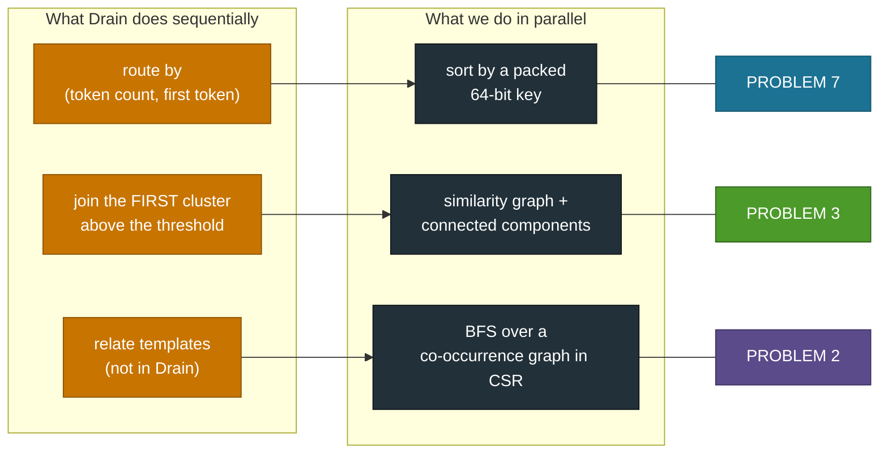
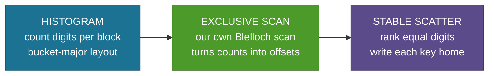
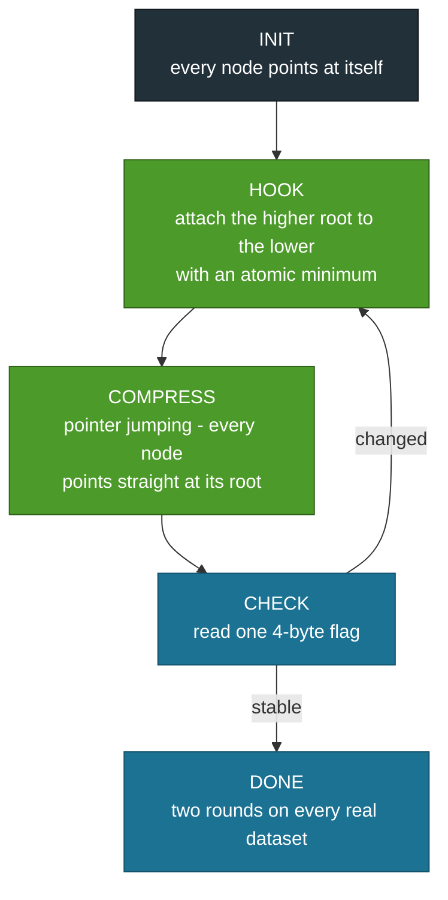
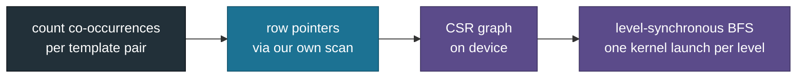

# TriParseGPU - Mapping to the Course Problems

Prof. Binod Kumar's problem set listed eight GPU problems. We used **three**.
This document explains which, why those three, how each is implemented, and at
what depth relative to what the statement asked for.

---

## Why we chose a project instead of a problem

The brief allowed either. We chose a single coherent system that *needs* three
of the problems working together, rather than three disconnected kernels, for
three reasons:

1. **The problems compose naturally.** Log parsing decomposes into exactly a
   sort, a graph labelling and a traversal. Nothing was forced.
2. **It raises the difficulty.** Each problem has to work on real, irregular
   data at real scale - not a synthetic array.
3. **It produces a paper.** A benchmarked kernel is coursework. A system that
   fills a nine-year-old gap in the literature is a submission.

---

## The mapping at a glance

Only the middle row is a real change of algorithm. The other two are changes of
**data structure**: a tree lookup becomes a sort key, and a cluster list becomes
a graph.

---

## Problem 7 - Parallel sorting and prefix scan

### Why this problem

Drain's parse tree is a lookup on `(token count, first token)`. That is not a
tree, it is a **sort key**. Pack the decision into one 64-bit integer, sort by
it, and every line Drain would route to the same leaf lands in one contiguous
segment.

### The bucket key

| bits 63-48 | bits 47-24 | bits 23-0 |
|---|---|---|
| token count (16) | first token hash (24) | second token hash (24) |

### What we implemented

**LSD radix sort**, stable with duplicates, 8 bits per pass, 8 passes:

**Blelloch work-efficient scan**, three kernels:
up-sweep reduction, scan the per-block totals, down-sweep plus fold offsets back.

Segment boundaries then come from a scan over key changes - no tree traversal
anywhere in the pipeline.

### Depth relative to the statement

The statement asked for a prefix scan. We built the scan **and** a radix sort on
top of it, then used the pair to replace a data structure in a real algorithm.

### What the measurements say

| | Ours | Library | Note |
|---|---|---|---|
| Scan, 100 M elements | 2.19 ms | CuPy 2.18 ms | parity; 732 of ~1,790 GB/s = 41% of peak |
| Radix, 11.2 M keys | 5.22 ms | CUB 2.20 ms | 2.4x behind, fully accounted for |

The optimisation worth reporting: our first version ranked equal digits by
having each thread count matching digits among all 256 earlier threads - a
serial loop. A **warp ballot**, where one instruction identifies every lane
sharing a digit, took the sort from 7.77 ms to 5.22 ms.

Why we remain behind CUB: it processes 8-16 items per thread; we process one,
so its histogram is smaller by the same factor. 45% of our per-pass time is
histogram and scan overhead, and our histogram is 11 M entries per pass,
scanned eight times.

### Files

`kernels/radix.cu`, `kernels/scan.cu`, `triparsegpu/radix.py`,
`triparsegpu/scan.py`, `triparsegpu/bucket.py`

---

## Problem 3 - Connected-component labelling

### Why this problem

This is the heart of the reformulation. Drain's one sequential step is
"join the first cluster above the similarity threshold". We replace it:

- build a **similarity graph** - an edge between two lines whose similarity
  reaches the threshold,
- the **connected components** of that graph are the clusters.

Order dependence disappears, because a component does not care which edge was
found first.

### What we implemented

**The convergence trick:** the loop needs to know whether anything changed. The
naive answer copies the whole label array to the host each round. Ours reads a
**single four-byte integer**, and on real data the loop converges in two rounds.

**Why the atomics are safe:** every writer stores the same value, so the races
are benign. The kernel needs no locking.

### The similarity kernel that feeds it

One **warp per line**, 32 lanes comparing 32 token positions, a shuffle
reduction summing the matches in five steps with no shared memory. The warp
walks back over `w` predecessors inside its own segment and emits an edge when
similarity reaches the threshold.

All-pairs inside a segment would be O(n^2) - the largest HDFS segment holds over
a million lines. The window bounds the work to 16n, and connected components
closes every gap the window left.

### Depth relative to the statement

The statement asked for labelling. We run it **iteratively to convergence** on a
16-million-edge graph built on-device in the same pipeline, with a
host-readback-free convergence test.

### Verification

- `scipy.sparse.csgraph.connected_components` on random graphs: 5,000 nodes,
  8,000 edges, five seeds
- all four real datasets, exact partition match

### What the measurements say

`ccl_hook` is 16.1% of kernel time at 460 GB/s with a long-scoreboard stall
ratio of 120 - the dependent-load pointer chase in root finding.
`similarity_edges` is 75.3% and is latency-bound on scattered edge writes
(see [PROJECT_STORY.md](PROJECT_STORY.md) section 10 for the diagnosis).

### Files

`kernels/similarity.cu`, `kernels/ccl.cu`, `triparsegpu/cluster.py`

---

## Problem 2 - BFS on a CSR graph

### Why this problem

Templates alone answer "what patterns exist". Operators need "when this alert
fires, what usually follows". Two templates **co-occur** if their lines fall
within a window of each other; BFS over that graph gives the blast radius.

This is the stage that turns a parser into something an on-call engineer uses -
and it needs no model, no training and no labels.

### What we implemented

The row pointers come from the **same scan kernel** used by the radix sort -
Problem 7 feeding Problem 2.

### Depth relative to the statement

The statement asked for BFS on a graph. We **build the graph on-device first**,
from parser output, in CSR, and then traverse it. The graph is a product of the
pipeline rather than an input to it.

### Verification

Matches `scipy.sparse.csgraph.shortest_path` exactly.

### Files

`kernels/cooccur.cu`, `triparsegpu/graph.py`

---

## The five problems we did not use, and why

| Problem | Why not |
|---|---|
| Matrix multiply / tiling | Dense linear algebra does not appear anywhere in a parser. Including it would have been decoration. |
| Histogram | We *do* use a histogram - inside the radix sort - but as a component of P7 rather than as a standalone deliverable. |
| Reduction | Likewise used (shuffle reductions in the similarity kernel, consensus) but subsumed by the stages above. |
| Stencil / convolution | No spatial locality in log data to exploit. |
| Sparse matrix-vector | Our graph work is BFS and labelling, not SpMV. We would have had to invent a use. |

We would rather defend three problems used at depth than list eight used
shallowly.

---

## Evidence each problem actually works

| Problem | Test file | Checked against |
|---|---|---|
| P7 scan | `tests/test_scan.py` | NumPy `cumsum`, 0 to 100 M elements |
| P7 radix | `tests/test_radix.py` | NumPy stable `argsort`, duplicate-heavy keys |
| P3 components | `tests/test_ccl.py` | `scipy.sparse.csgraph.connected_components` |
| P3 similarity | `tests/test_cluster.py` | Python positional comparison |
| P2 BFS | `tests/test_graph.py` | `scipy.sparse.csgraph.shortest_path` |
| End to end | `tests/test_pipeline.py` | Drain3 clustering, ARI |

84 tests, all passing.

---

## Summary table for the report

| Problem | Statement asked for | We delivered | Where |
|---|---|---|---|
| **7** | parallel prefix scan | Blelloch scan + LSD radix sort over a packed 64-bit key, replacing Drain's parse tree | stages 3-4 |
| **3** | connected-component labelling | iterative hook + pointer jumping to convergence on a 16 M-edge similarity graph, with a 4-byte convergence test | stages 5-6 |
| **2** | BFS on a graph | on-device co-occurrence graph construction in CSR, then level-synchronous BFS | stage 8 |
