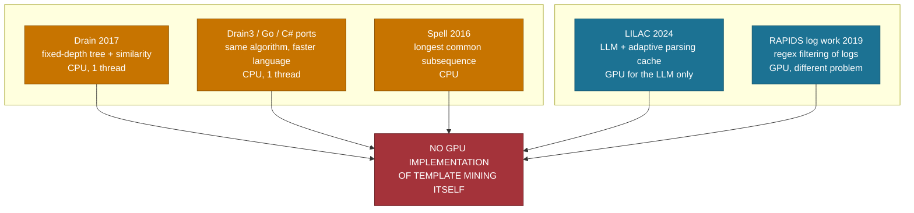
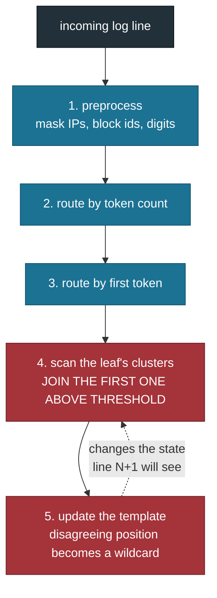
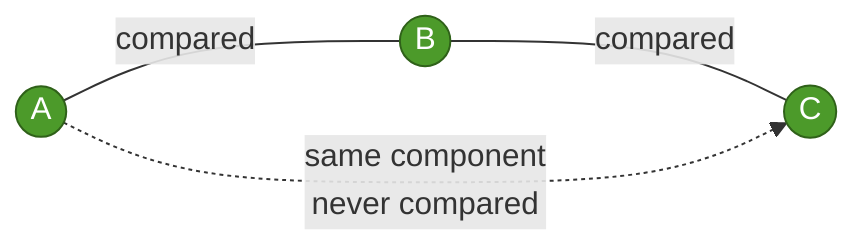
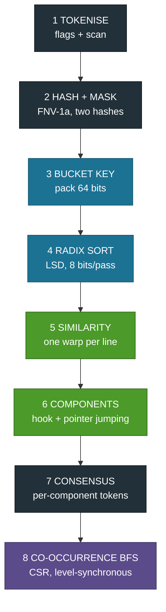
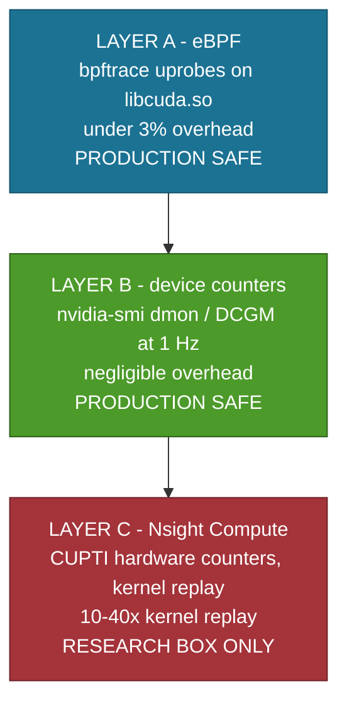
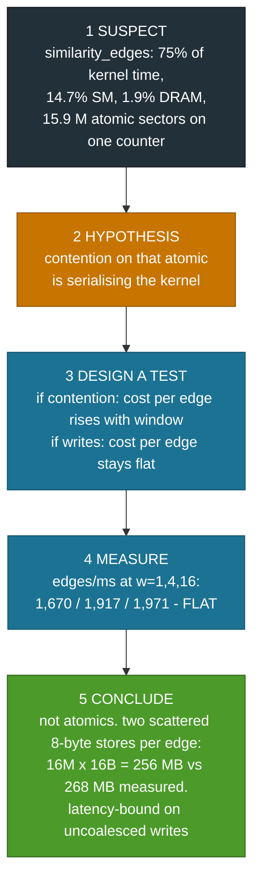
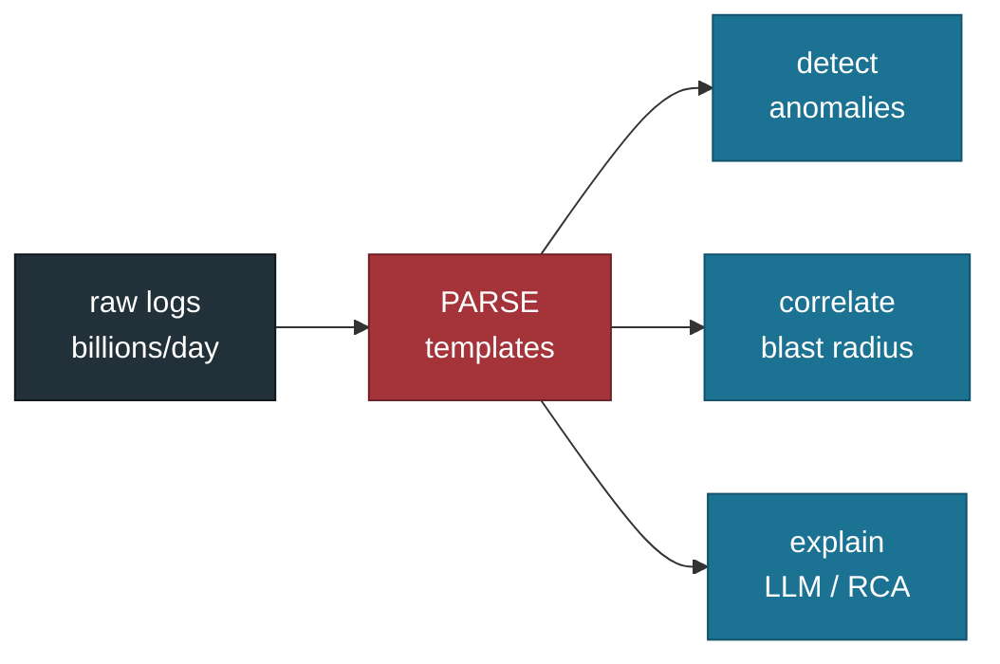

# TriParseGPU - Why We Built It, and How

The full story of the project, from choosing the problem to the final numbers.
Read this first if you want to understand *why* each decision was made.

---

## 1. The problem we went looking for

The course asked for a project built on one or more of eight GPU problems.
We did not want to implement a textbook kernel and benchmark it. We wanted a
problem where:

1. a real bottleneck exists in production systems,
2. nobody has solved it on a GPU yet,
3. the solution needs several of the professor's problems together, and
4. the result is publishable.

We found one in log parsing.

### What log parsing is

Every system writes logs. Before anything can be done with them - anomaly
detection, root cause analysis, feeding a language model - each raw line is
reduced to a **template** plus its **parameters**.

```
connected to 10.0.0.7 port 22      ->  connected to <*> port <*>
connected to 10.0.0.9 port 22      ->  connected to <*> port <*>
                                       parameters: 10.0.0.7, 10.0.0.9
```

The compression is enormous:

| Dataset | Lines | Distinct templates |
|---|---|---|
| HDFS | 11,175,629 | 51 |
| BGL | 4,747,963 | 206 |
| Thunderbird | 2,000,000 | 1,183 |
| OpenStack | 137,074 | 47 |

### Why it is a bottleneck

The standard algorithm is **Drain** (He et al., ICWS 2017). Drain3 (IBM's
Python implementation), the Go port and the C# port are all single-threaded
CPU code. Our own measurements on the same machine:

| Dataset | Drain3 lines/s | Templates |
|---|---|---|
| Thunderbird | 8,475 | 1,183 |
| OpenStack | 31,795 | 47 |
| BGL | 45,418 | 206 |
| HDFS | 79,919 | 51 |

At 80,000 lines/s, **one billion lines takes 3 hours 28 minutes on a single
core** - before any analysis begins. Production systems emit billions a day.

---

## 2. The gap



**Why the gap survived nine years:** Drain is sequential by construction, GPU
researchers do not work on logs, and log researchers do not write CUDA. The
two communities barely overlap.

---

## 3. Why Drain is sequential



Steps 4 and 5 are the problem. **"First match wins"** means line N depends on
the clusters built from lines 1..N-1. A GPU needs thousands of independent work
items; Drain hands it a chain.

### Three observations that unlocked it

1. The parse tree is just a **lookup on (token count, first token)** - that is
   a sort key, not a tree.
2. Similarity is **positional token equality** - no edit distance, no sequence
   alignment. It parallelises trivially.
3. "First match wins" is the **only** sequential step.

---

## 4. Batch-Drain: our reformulation

Replace the sequential cluster assignment with a graph problem.


### Why this is correct

A **bounded window plus transitive closure** recovers the clusters Drain would
have built. If A~B and B~C, connected components puts A, B and C together even
though A and C were never compared.



Measured on BGL: grouping accuracy is **identical at w=16 and w=128**, while
the edge count grows fivefold.

| window | GA (BGL) | edges |
|---|---|---|
| 4 | 0.9540 | 7,136 |
| 8 | 0.9580 | 13,587 |
| **16** | **0.9685** | **25,382** |
| 32 | 0.9685 | 45,914 |
| 64 | 0.9685 | 79,509 |
| 128 | 0.9685 | 129,598 |

> **Honest caveat.** We have strong empirical evidence and a proof sketch, not
> a formal proof. This is the weakest point in the paper and a reviewer will
> ask about it.

### What order-independence bought us

| Dataset | ARI vs Drain3 |
|---|---|
| BGL | 1.0000 |
| HDFS | 1.0000 |
| Thunderbird | 0.9999 |
| OpenStack | 0.9777 |

Three datasets: **exact agreement**. The reformulation is not an approximation.

OpenStack diverges - **toward the truth**. Our GA there is 0.8070 against
Drain3's 0.7325, so where we disagree, we are closer to the human ground truth.

---

## 5. The design point that mattered most

Preprocessing masks parameters *inside* tokens, producing literals like
`blk_<*>`. Those are still literal text and must appear in the template.
But using them in the bucket key gives every partially-masked UUID its own
cluster.

**The fix: two hashes.**

```c
out_wild[t]  = wild ? 1 : 0;
out_hash[t]  = wild ? 0ULL : h;                      // similarity + template text
out_bhash[t] = (wild || has_marker) ? 0ULL : h;      // bucketing only
```

| OpenStack (full) | Before | After |
|---|---|---|
| Templates | 15,791 | **47** |
| Singletons | 6,679 | **3** |
| Grouping accuracy | 0.7325 | **0.8070** |

This is not just a bug we fixed in our own code. It sidesteps a **structural
weakness in Drain's own first-token routing** - which is why an order-independent
method can beat the sequential original. It is a contribution.

---

## 6. What we built

### Eight stages, seven hand-written kernels



Blue = Problem 7 (sort/scan) · Green = Problem 3 (components) ·
Violet = Problem 2 (BFS) · Grey = supporting stages

**Mnemonic: "THe BaSiC TeaM Goes"** - Tokenise, Hash, Bucket, Sort, Compare,
Tie together, Merge, Graph.

**One rule the design obeys:** nothing returns to the host between stages
except a single four-byte convergence flag per labelling round.

### Three tiers, and why all three exist

| Tier | What | Why it exists | Speed |
|---|---|---|---|
| 0 | Drain3 CPU | Ground-truth clusters, the baseline every speedup divides by | 8k-80k lines/s |
| 1 | CuPy library primitives | Proves the formulation works before any hand-written kernel | 23.8-66.5 M/s |
| 2 | Hand-written CUDA | The course deliverable, the Problem 7 answer | 23.7-65.5 M/s |

Tiers 1 and 2 give **identical accuracy** on all four datasets. That is how we
know the hand-written kernels are correct, not merely fast.

---

## 7. What the measurements told us

### Hand-written vs library (Problem 7, answered with data)

| Primitive | Ours | Library | Verdict |
|---|---|---|---|
| Scan, 100 M elements | 2.19 ms | CuPy 2.18 ms | parity |
| Radix sort, 11.2 M keys | 5.22 ms | CUB 2.20 ms | 2.4x behind |

We can account for the whole radix gap: CUB processes 8-16 items per thread,
we process one, which shrinks its histogram by the same factor. 45% of our
per-pass time is histogram and scan overhead.

**But end to end it barely matters** - substituting our kernels costs 1.6% on
BGL, 0.9% on Thunderbird, 1.6% on HDFS, 7.2% on OpenStack (too small to
amortise the sort).

**Where no library exists** - connected components, the similarity kernel,
template consensus, the co-occurrence graph - those are hand-written in both
tiers, and they are 95% of kernel time.

### Three findings we did not plan for

1. **Drain slows as templates accumulate.** BGL falls from 53,600 to 48,400
   lines/s *within a single run* as templates grow 61 -> 157. Thunderbird runs
   at 8,475 with 1,183 templates. Drain scans the cluster list at each leaf; we
   sort, so we have no slope. **Our advantage grows exactly where logs are
   hardest.**
2. **Window 16 equals window 128** - identical accuracy, five times fewer edges.
3. **Separating the bucket hash** turned 15,791 templates into 47 and pushed
   accuracy above the CPU reference.

All three came from measurement, not design.

---

## 8. The optimisations that mattered

| Change | Before | After | Why |
|---|---|---|---|
| Consensus thread mapping | 113 ms | 1.1 ms | 36 components on 188 SMs left the device 80% idle. One thread per (line, token) pair instead of one block per component. |
| Pinned host memory | 1.2 GB/s | 13.2 GB/s | DMA from page-locked memory. One line of code. |
| Warp-ballot radix ranking | 7.77 ms | 5.22 ms | A serial loop over 256 earlier threads became one ballot instruction. |
| Bucket hash separation | GA 0.7325 | GA 0.8070 | See section 5. |

**The lesson:** thread mapping beat algorithm tuning. The 100x came from
changing *how work was assigned*, not from a better algorithm.

---

## 9. Observability - three layers



**Rule we worked to:** start at the cheapest layer that can answer the
question, escalate only when it cannot. We reached for Nsight exactly once -
after eBPF had already shown launch overhead was 13% and therefore not the
problem.

### Two negative results worth publishing

- **eBPF hits a static runtime.** 167 probes on memory transfer and
  synchronisation attached and never fired. CuPy's wheel links the CUDA runtime
  statically, so there is no `libcudart.so` to probe. Launches work only because
  they funnel through the driver library.
- **1 Hz sampling has a resolution floor.** 6 of 62 samples recorded any
  activity, ranging 10%-99% SM. The pipeline does ~75 ms of GPU work per
  invocation; most samples land between launches.

Both apply to anyone profiling a Python GPU service - which is most of AI
infrastructure.

---

## 10. Finding the real bottleneck

A worked example of the method.



The first explanation was wrong. Only a designed experiment separated the two.
**The fix follows from the diagnosis: emit fewer edges, do not write them faster.**

---

## 11. How we kept ourselves honest

1. **Gate on accuracy first.** No speed claim was allowed until grouping
   accuracy matched the published Drain benchmark. That took two attempts and a
   careful read of the `logparser` benchmark source - our guessed masks were
   wrong, and the real settings are per-dataset regexes with st=0.5 and depth
   4 or 5.
2. **Keep a working tier alive.** Tier 1 stayed runnable throughout.
3. **Test every stage against a CPU reference.** `str.split` for tokens,
   NumPy stable argsort for the sort, scipy for components and BFS, Drain3
   end to end. 84 tests.
4. **Lock clocks, median of five.** Never the mean. One warm-up discarded. The
   harness refuses to report a locked-clock number unless clocks are locked.
5. **Report the unflattering column.** Kernels only, plus transfer, and end to
   end. The last one is 2.4x, not 230x - and it is in the paper.
6. **Cross-check every measurement.** Two independent profiles. It caught a
   wrong-by-1000x number that looked entirely reasonable (Nsight auto-scales
   units per row; summing the raw value column mixes ns, us and ms).

---

## 12. What this is for



Nothing downstream works on raw text. Parsing is stage one, and on CPU it is
also the slowest stage. A parser running at 65 million lines/s moves the
bottleneck off stage one for the first time.

> **Be precise about the claim.** We measured parsing, not downstream model
> quality. What this work establishes is that the reduction step is no longer
> the constraint. Whether a model reasons better over templates is a separate
> study, named in future work rather than asserted here.

---

## 13. In one sentence

> Drain, reformulated as sort plus graph plus connected components, running on
> a GPU at two to three orders of magnitude the speed - with the same clusters,
> and on one dataset better ones.

| | |
|---|---|
| 820-2,791x | over the CPU reference |
| 3 of 4 | datasets at or above it on accuracy |
| 84 | tests, every stage verified |
| 0 | GPU log-template parsers before this one |
