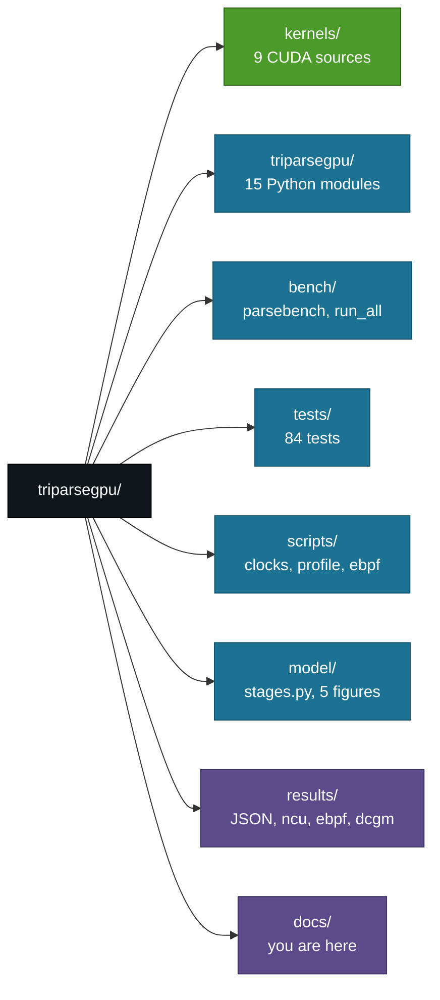

# TriParseGPU - Documentation Index

GPU-native log template mining for large-scale system logs.

**IIT Jodhpur · M.Tech (AI) · GPU Programming · Prof. Binod Kumar**
Rohit Patel (G25AIT2089) · Jeenal Chaudhary (G25AIT2027) ·
Kosuru Yuvaraj (G25AIT2054) · Sharvan Vittala (G25AIT2099)

---

## Start here

| If you want to... | Read |
|---|---|
| Understand what this project is and why it exists | [PROJECT_STORY.md](PROJECT_STORY.md) |
| Answer a question in the viva, fast | [VIVA_CHEATSHEET.md](VIVA_CHEATSHEET.md) |
| Learn the whole system properly | [MASTER_GUIDE.md](MASTER_GUIDE.md) |
| Read or change the code | [CODE_WALKTHROUGH.md](CODE_WALKTHROUGH.md) |
| Know how this maps to the course problems | [PROBLEM_MAPPING.md](PROBLEM_MAPPING.md) |
| Run it on the GPU box | [RUNBOOK.md](RUNBOOK.md) |
| Read the design rationale and kernel listings | [DESIGN.md](DESIGN.md) |
| Hand it to a new team member | [TriParseGPU_HANDBOOK.md](TriParseGPU_HANDBOOK.md) |

---

## The project in five lines

Log parsing turns `connected to 10.0.0.7 port 22` into the template
`connected to <*> port <*>`. Every log pipeline in production does this first,
and every implementation is single-threaded CPU code running at 8k-80k lines/s.
We reformulated the standard algorithm (Drain) so it is order-independent,
implemented it as eight GPU stages with seven hand-written CUDA kernels, and
measured 23.7-65.5 million lines/s - at or above the CPU reference on accuracy.

---

## Headline results

### Accuracy (LogHub-2k, tier 2, window 16)

| Dataset | GA | PA | FGA | ARI vs Drain3 | Drain3 GA |
|---|---|---|---|---|---|
| BGL | 0.9685 | 0.8115 | 0.8444 | 1.0000 | 0.9625 |
| HDFS | 0.9975 | 0.8085 | 0.8667 | 1.0000 | 0.9975 |
| Thunderbird | 0.9425 | 0.1770 | 0.7045 | 0.9999 | 0.9550 |
| OpenStack | **0.8070** | 0.0720 | 0.6933 | 0.9777 | 0.7325 |

### Throughput (full datasets, tier 2, locked clocks, median of 5)

| Dataset | Lines | GPU kernels | GPU +H2D | Speedup |
|---|---|---|---|---|
| OpenStack | 137,074 | 26.3 M/s | 22.1 M/s | 826x |
| BGL | 4,747,963 | 63.5 M/s | 50.8 M/s | 1,398x |
| Thunderbird | 2,000,000 | 23.7 M/s | 21.5 M/s | 2,791x |
| HDFS | 11,175,629 | 65.5 M/s | 49.2 M/s | 820x |

### Per-kernel profile (BGL 1M, tier 2, idle GPU)

| Kernel | Total us | % | Mean SM % |
|---|---|---|---|
| similarity_edges | 8,300 | 75.3 | 14.7 |
| ccl_hook | 1,773 | 16.1 | 8.0 |
| consensus_reduce | 401 | 3.6 | 22.0 |
| block_scan | 160 | 1.5 | 19.7 |
| radix_scatter | 112 | 1.0 | 30.3 |
| radix_histogram | 95 | 0.9 | 22.0 |
| hash_tokens | 87 | 0.8 | 69.4 |
| add_offsets | 64 | 0.6 | 6.3 |
| ccl_compress | 23 | 0.2 | 9.4 |

Total 11.0 ms over 54 launches.

---

## Repository map

---

## Environment

| | |
|---|---|
| GPU | NVIDIA RTX PRO 6000 Blackwell Max-Q Workstation Edition, 96 GB |
| Compute capability | 12.0 (`sm_120`) |
| CUDA | 13.2, driver 595.58.03 |
| Harness | Python 3.12, CuPy, NumPy, pandas, pytest |
| Reference | Drain3, scipy, scikit-learn |
| Profiling | Nsight Compute / Systems, bpftrace + BCC, NVIDIA DCGM |

---

## Status

Steps 1-10 of 11 complete: setup, data, Drain3 baseline, tier-1 pipeline,
tier-2 kernels, accuracy gate, benchmark sweep, profiling, figures, docs.
Step 11 - the course report and the paper - is the remaining work.

Open items are listed at the end of [MASTER_GUIDE.md](MASTER_GUIDE.md).
