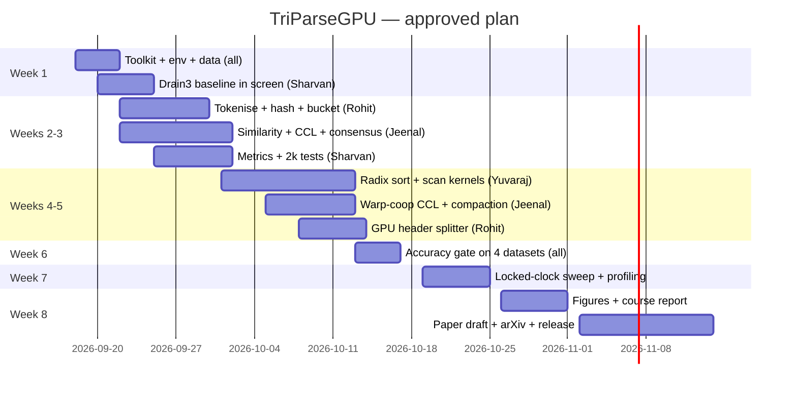

# TriParseGPU — Execution Runbook

Approved by Prof. Binod Kumar, 16 Sep 2026. Four members. Start date: 18 Sep 2026.
Machine: RTX PRO 6000 Blackwell Max-Q, 96 GB — **shared with other running projects**, so every rule below about screen sessions and GPU etiquette is load-bearing.

---

## 0. GPU sharing rules (read before anything else)

Other work (vLLM servers, serving experiments) already sits on this card. TriParseGPU must not kill them, and their memory must not corrupt your benchmark numbers.

**Rule 1 — Know what's running before you launch.**

```bash
nvidia-smi --query-compute-apps=pid,process_name,used_memory --format=csv
nvidia-smi --query-gpu=memory.used,memory.total,utilization.gpu --format=csv
```

**Rule 2 — Cap your memory so you can't starve a serving process.**
CuPy honours a pool limit. Put this at the top of every driver script, or export it:

```bash
export CUPY_GPU_MEMORY_LIMIT="40GB"      # dev work; raise only for the final Thunderbird run
```

```python
import cupy as cp
cp.get_default_memory_pool().set_limit(size=40 * 1024**3)
```

**Rule 3 — Never lock clocks while someone else is benchmarking.**
`nvidia-smi -lgc` is global. Coordinate before the paper sweep (Step 8); it is the only time you need it. Same for MPS — don't enable it.

**Rule 4 — Never run `ncu` on a busy GPU.**
Nsight Compute serialises and replays kernels; it will wreck any concurrent job's latency. Profiling happens in a booked window only (Step 9).

**Rule 5 — Free memory when idle.** Long-lived Python sessions hold the pool. Exit the REPL or call `cp.get_default_memory_pool().free_all_blocks()` before stepping away.

---

## 1. Screen session plan

Everything long-running goes in a named screen. Naming convention `tpg_<purpose>` so your other projects' sessions stay distinguishable.

| Session | What runs in it | Typical duration | Detach-safe |
|---|---|---|---|
| `tpg_setup` | toolkit install, pip installs | 30–60 min | yes |
| `tpg_data` | LogHub download + extraction | 1–3 h | yes |
| `tpg_drain3` | Tier-0 CPU baseline on full datasets | **8–40 h** (Thunderbird) | yes — must be screened |
| `tpg_dev` | interactive kernel work, pytest | ongoing | yes |
| `tpg_bench` | the locked-clock sweep | 2–6 h | yes — must be screened |
| `tpg_prof` | ncu / nsys / bpftrace runs | 1–2 h | yes |
| `tpg_watch` | `watch nvidia-smi` + dcgmi dmon | always on | yes |

Core commands:

```bash
screen -S tpg_drain3          # create + attach
# Ctrl-A then D               # detach, leaves it running
screen -ls                    # list all sessions
screen -r tpg_drain3          # reattach
screen -S tpg_drain3 -X quit  # kill
# run a command directly in a new detached session:
screen -dmS tpg_bench bash -c 'cd ~/triparsegpu && bash bench/run_all.sh 2>&1 | tee logs/bench.log'
```

Always `tee` to a log file — screen's scrollback is finite and you will want the output for the paper.

Enable screen logging once, in `~/.screenrc`:

```
defscrollback 20000
logfile ~/screenlogs/%S-%Y%m%d-%c.log
deflog on
```

---

## 2. Week-by-week plan



---

## 3. Day 1 — Setup (`tpg_setup`)

```bash
screen -S tpg_setup
```

Check what's already there before installing anything:

```bash
nvidia-smi --query-gpu=name,driver_version,compute_cap,memory.total --format=csv
which nvcc || echo "nvcc missing"
nvidia-smi --query-compute-apps=pid,process_name,used_memory --format=csv   # who else is on the card
```

Toolkit (does **not** touch the driver, so running jobs survive):

```bash
wget https://developer.download.nvidia.com/compute/cuda/repos/ubuntu2404/x86_64/cuda-keyring_1.1-1_all.deb
sudo dpkg -i cuda-keyring_1.1-1_all.deb && sudo apt-get update
sudo apt-get install -y cuda-toolkit-13-2 nsight-compute nsight-systems
echo 'export PATH=/usr/local/cuda/bin:$PATH' >> ~/.bashrc
echo 'export LD_LIBRARY_PATH=/usr/local/cuda/lib64:$LD_LIBRARY_PATH' >> ~/.bashrc
source ~/.bashrc && nvcc --version
```

Do **not** `apt upgrade` the driver — that would need a GPU reset and kill every other project's process.

Isolated Python env (never touch the vLLM env):

```bash
mkdir -p ~/triparsegpu && cd ~/triparsegpu
python3 -m venv .venv && source .venv/bin/activate
pip install --upgrade pip
pip install cupy-cuda13x numpy pandas matplotlib pyyaml pytest drain3 regex tqdm scikit-learn
python -c "import cupy, drain3; print(cupy.__version__)"
```

Smoke test with a memory cap, so this can't disturb anything:

```bash
CUPY_GPU_MEMORY_LIMIT=8GB python -c "
import cupy as cp; a=cp.arange(10**7); print(a.sum())"
```

Detach: `Ctrl-A D`.

---

## 4. Day 1–2 — Data (`tpg_data`)

```bash
screen -S tpg_data
cd ~/triparsegpu
```

Full LogHub sets are already on the box from TriCalRAG — symlink, don't re-download:

```bash
ls ~/datasets/loghub                     # confirm the path first
mkdir -p data && ln -sfn ~/datasets/loghub data/full
du -sh data/full/*
```

Only the 2k ground-truth sets are new:

```bash
git clone --depth 1 https://github.com/logpai/logparser /tmp/logparser
mkdir -p data/2k
for D in BGL HDFS Thunderbird OpenStack; do cp -r /tmp/logparser/data/loghub_2k/$D data/2k/; done
ls data/2k/*/*_2k.log_structured.csv
```

Verify the ground truth has what you need:

```bash
python -c "
import pandas as pd
df = pd.read_csv('data/2k/HDFS/HDFS_2k.log_structured.csv')
print(df.columns.tolist()); print(df[['Content','EventTemplate']].head())"
```

---

## 5. Day 2–6 — Tier 0 baseline (`tpg_drain3`) ← **the long one**

This is pure CPU, so it can run alongside everything else. Thunderbird at ~100k lines/s is over 30 hours — it must be screened, and start it early because every speedup number divides by it.

```bash
screen -S tpg_drain3
cd ~/triparsegpu && source .venv/bin/activate
mkdir -p logs results/baseline
```

Small sets first (minutes):

```bash
for D in BGL HDFS Thunderbird OpenStack; do
  python -m triparsegpu.ref_drain3 data/2k/$D/${D}_2k.log_structured.csv \
    2>&1 | tee -a logs/drain3_2k.log
done
```

Then the full sets, smallest first, one at a time (don't parallelise — you're measuring single-thread throughput):

```bash
nice -n 10 python -m triparsegpu.ref_drain3 data/full/OpenStack/openstack_normal2.log --raw 2>&1 | tee logs/drain3_openstack.log
nice -n 10 python -m triparsegpu.ref_drain3 data/full/BGL/BGL.log --raw            2>&1 | tee logs/drain3_bgl.log
nice -n 10 python -m triparsegpu.ref_drain3 data/full/HDFS/HDFS.log --raw          2>&1 | tee logs/drain3_hdfs.log
nice -n 10 python -m triparsegpu.ref_drain3 data/full/Thunderbird/Thunderbird.log --raw 2>&1 | tee logs/drain3_thunderbird.log
```

`nice -n 10` keeps it from competing with anything interactive. Detach and forget it for a few days.

Also run the Go port as the stronger CPU baseline, or reviewers will call the speedup "Python vs CUDA":

```bash
# in the same screen, after the Python runs finish
go install github.com/faceair/drain3-go/...@latest   # or the port you pick; verify it exists first
```

---

## 6. Weeks 2–3 — Tier 1 development (`tpg_dev`)

```bash
screen -S tpg_dev
cd ~/triparsegpu && source .venv/bin/activate
export CUPY_GPU_MEMORY_LIMIT=40GB
```

Build order — each step has a test that must pass before the next starts:

| Order | Component | Owner | Test |
|---|---|---|---|
| 1 | `io.py` header stripping | Rohit | `Content` column matches the 2k CSV exactly |
| 2 | `tokenize.py` (CuPy primitives) | Rohit | token counts match a Python `str.split()` reference |
| 3 | `kernels/hash.cu` | Rohit | same string → same hash; wildcards flagged for IP/num/hex |
| 4 | `bucket.py` (`cupy.argsort`) | Rohit | segments are contiguous and sorted |
| 5 | `kernels/similarity.cu` | Jeenal | edge set matches a NumPy brute-force on 1k lines |
| 6 | `kernels/ccl.cu` | Jeenal | matches `scipy.sparse.csgraph.connected_components` |
| 7 | `kernels/template.cu` | Jeenal | consensus matches a Python reference per component |
| 8 | `metrics.py` | Sharvan | GA/PA reproduce published Drain3 numbers on the 2k sets |

Work on the 2k sets only during development — they run in seconds and use almost no GPU memory, so your teammates never notice you're there.

```bash
pytest -q tests/ 2>&1 | tee logs/tests_$(date +%F).log
```

Quick end-to-end check once stages 1–7 exist:

```bash
python -c "
from triparsegpu.pipeline import parse
t,i,T = parse('data/2k/HDFS/HDFS_2k.log','HDFS',tier=1)
print(len(t),'templates'); print(T)"
```

---

## 7. Weeks 4–5 — Tier 2 kernels (`tpg_dev`)

Three replacements, each gated by its own test:

```bash
pytest -q tests/test_sort.py     # radix vs numpy stable argsort, incl. duplicate keys
pytest -q tests/test_scan.py     # Blelloch + decoupled-lookback vs numpy cumsum
pytest -q tests/test_ccl.py      # warp-coop CCL vs scipy
```

Keep tier 1 working the whole time. Every benchmark runs both tiers; if tier 2 regresses, tier 1 is still a publishable result.

---

## 8. Week 6 — Accuracy gate (`tpg_dev`) — **do not skip**

```bash
pytest -q tests/test_pipeline_accuracy.py -s 2>&1 | tee logs/accuracy_gate.log
```

Pass condition: GA and PA within 1 point of Drain3 on all four 2k sets, Drain3 parity (ARI) ≥ 0.95. Fail → fix similarity threshold, window size, or the wildcard rule; do not proceed to benchmarking. Record the table either way; a dataset where batch-CCL diverges from sequential Drain is a finding worth a paragraph.

---

## 9. Week 7 — Benchmark sweep (`tpg_bench`) — **book the GPU first**

Message your other projects. This window needs exclusive use for clean numbers.

```bash
nvidia-smi --query-compute-apps=pid,process_name,used_memory --format=csv   # should be empty
sudo nvidia-smi -pm 1
sudo nvidia-smi -lgc 2000,2000
export CUPY_GPU_MEMORY_LIMIT=85GB          # now you can use the card properly

screen -dmS tpg_bench bash -c 'cd ~/triparsegpu && source .venv/bin/activate && bash bench/run_all.sh 2>&1 | tee logs/bench_$(date +%F).log'
```

Monitor from a second screen:

```bash
screen -S tpg_watch
watch -n 2 nvidia-smi
# or, if dcgm is installed:
dcgmi dmon -e 1002,1003,1005,1009,1010,155 -d 100 | tee results/dcgm/sweep.csv
```

When it finishes — **always unlock**:

```bash
sudo nvidia-smi -rgc
```

Thunderbird runs twice: single-batch (all 211M lines resident) and 16M-line streaming batches. Both numbers go in the paper.

---

## 10. Week 7 — Profiling (`tpg_prof`) — exclusive window too

Three layers, in increasing intrusiveness:

```bash
screen -S tpg_prof
cd ~/triparsegpu && source .venv/bin/activate

# A — eBPF (safe even with others running)
CUDALIB=$(ldconfig -p | awk '/libcuda.so.1 /{print $NF; exit}')
sudo bpftrace scripts/ebpf/cuda_launch_latency.bt \
  -c "python bench/parsebench.py --dataset BGL --tier 2 --limit 1000000 --reps 1 --out /tmp/x.json" \
  2>&1 | tee logs/ebpf_launch.log
sudo bpftrace scripts/ebpf/cuda_sync_stalls.bt \
  -c "python bench/parsebench.py --dataset BGL --tier 2 --limit 1000000 --reps 1 --out /tmp/x.json" \
  2>&1 | tee logs/ebpf_sync.log

# B — DCGM (safe)
dcgmi dmon -e 1002,1003,1005,1009,1010 -d 100 > results/dcgm/BGL_t2.csv &
python bench/parsebench.py --dataset BGL --tier 2 --limit 10000000 --reps 3 --out /tmp/x.json
kill %1

# C — Nsight Compute (EXCLUSIVE — kills concurrent jobs' latency)
nvidia-smi --query-compute-apps=pid,process_name --format=csv    # must be empty
bash scripts/profile.sh BGL 2 1000000 2>&1 | tee logs/ncu.log
```

Layer C needs `NVreg_RestrictProfilingToAdminUsers=0`, which requires a reboot — schedule it when nothing else is running, or run `ncu` under `sudo` if your driver build allows it.

---

## 11. Week 8 — Figures, report, release (`tpg_dev`)

```bash
GPU=$(nvidia-smi --query-gpu=name --format=csv,noheader | tr ' ' '_')
python model/stages.py results/$GPU
python model/roofline.py results/ncu
bash scripts/reproduce.sh 2>&1 | tee logs/reproduce.log
git tag v1.0 && git push --tags
```

---

## 12. Daily habits

```bash
screen -ls                                                   # what of mine is alive
nvidia-smi --query-compute-apps=pid,process_name,used_memory --format=csv    # who else is on the card
tail -f ~/triparsegpu/logs/<current>.log                     # progress without reattaching
```

If a screen session dies mid-run, the `tee` log tells you where it stopped. If the GPU shows your PID holding memory after a crash:

```bash
kill <pid>            # graceful first
nvidia-smi            # confirm memory released
```

Never `nvidia-smi --gpu-reset` on this box — it takes down every other project.

---

## 13. Weekly checkpoint with the team

Friday, 30 minutes, four items:
1. Which tests went green this week.
2. Current GA/PA numbers on the 2k sets (even if failing).
3. Blockers needing an exclusive GPU window.
4. Which paper section each person's work has landed in.

Keep a `PROGRESS.md` in the repo with these — it becomes the course report's timeline section for free.
