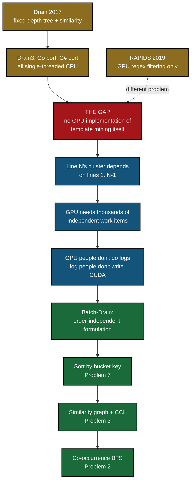
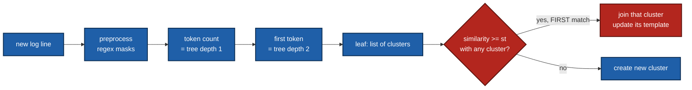
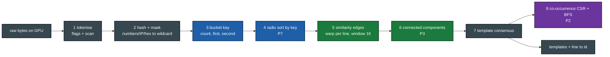

# TriParseGPU — Team Handbook

**GPU-Native Log Template Mining for Large-Scale System Logs**
GPU Programming · M.Tech (AI) · IIT Jodhpur · Prof. Binod Kumar
Rohit Patel (G25AIT2089) · Jeenal Chaudhary (G25AIT2027) · Kosuru Yuvaraj (G25AIT2054) · Sharvan Vittala (G25AIT2099)
Machine: NVIDIA RTX PRO 6000 Blackwell Max-Q · 96 GB · CC 12.0 · CUDA 13.2 · driver 595.58.03
Repo: `github.com/rpaut03l/triparsegpu` (private)

---

## 0. The one-paragraph version

Every system writes logs — billions of lines a day. Before anyone can use them,
each line must be grouped into a *template*: `connected to 10.0.0.7 port 22`
becomes `connected to <*> port <*>`. The standard algorithm, **Drain**, does this
one line at a time on a single CPU core at 8k–80k lines/s. We rewrote it as three
things a GPU is good at — **sort**, **compare in parallel**, **group** — and it now
runs at 23–65 million lines/s with the same or better accuracy.

---

## 1. The gap, and what we closed



**Reading it top to bottom:** gold = prior work · red = the gap ·
blue = why nobody closed it · green = what we built.

**The gap in one line:** Drain is sequential by construction, so no GPU version
existed, so every log-analysis and AIOps pipeline is bottlenecked at step one.

**What we found:** the clustering can be expressed as *sort → similarity graph →
connected components*, which removes the line-to-line dependency entirely. A
bounded comparison window plus transitive closure recovers the same clusters.

---

## 2. Core concepts — know these cold

### 2.1 Log parsing vocabulary

| Term | Meaning |
|---|---|
| **Raw line** | `081109 203615 148 INFO dfs.DataNode$PacketResponder: PacketResponder 1 for block blk_38865049064139660 terminating` |
| **Header** | Everything before `<Content>` — date, time, pid, level, component |
| **Content** | The part that gets parsed: `PacketResponder 1 for block blk_... terminating` |
| **Template** | `PacketResponder <*> for block blk_<*> terminating` |
| **Parameter** | The values the wildcards replaced: `1`, `38865049064139660` |
| **Event / cluster id** | Which template a line belongs to |
| **Ground truth** | Human-labelled templates in LogHub's `_structured.csv` |

### 2.2 How Drain works (what we replaced)



The two red boxes are the sequential part — the only thing standing between
Drain and a GPU.

Three things to notice, because all three are what we exploit:
1. The tree is just a **lookup by (token count, first token)** — that is a sort key.
2. "First match wins" is the **only** sequential part.
3. Similarity is **positional token equality** — embarrassingly parallel.

### 2.3 Our reformulation: Batch-Drain



Colour key: **blue = Problem 7 (sort/scan)** · **green = Problem 3 (CCL)** ·
**purple = Problem 2 (BFS)** · **grey = supporting stages**

**The key insight:** sorting by bucket key puts every line Drain would route to
the same tree leaf into one contiguous segment. Inside a segment, compare each
line against its `window` predecessors. Connected components then merge
transitively — so A~B and B~C puts A, B, C together even if A and C were never
directly compared.

### 2.4 The three GPU primitives

| Primitive | What it does | Where we use it | Course problem |
|---|---|---|---|
| **Scan** (prefix sum) | turn counts into offsets | token offsets, CSR row pointers, radix histogram | P7 |
| **Radix sort** | stable sort by integer key | group lines by bucket | P7 |
| **CCL** (connected components) | label graph components | merge similar lines into clusters | P3 |
| **BFS** | shortest path in a graph | which events follow which | P2 |

### 2.5 CUDA concepts used in this project

| Concept | Where it appears | Why |
|---|---|---|
| **Thread per element** | `hash_tokens`, `mark_newlines` | simplest mapping, fully parallel |
| **Warp per element** | `similarity_edges` | 32 lanes compare 32 token positions at once |
| **Warp shuffle** (`__shfl_down_sync`) | similarity reduction | sum 32 lanes without shared memory |
| **Ballot** (`__ballot_sync`) | radix scatter ranking | which lanes share my digit — one instruction vs 256 loop iterations |
| **Shared memory** | radix histogram, template consensus | block-local scratchpad, ~100× faster than global |
| **Atomics** | edge counter, histogram, CCL hook | safe concurrent updates |
| **Blelloch scan** | `scan.cu` | work-efficient O(n) prefix sum, up-sweep then down-sweep |
| **Pointer jumping** | `ccl_compress` | flatten the union-find tree so every node points at its root |
| **Pinned memory** | `gpuio.to_gpu_pinned` | DMA transfer: 13.2 GB/s vs 1.2 GB/s pageable |
| **Convergence flag** | CCL and BFS loops | read ONE int per round instead of the whole array |

### 2.6 Infrastructure analogies (if you think in SRE terms)

| GPU concept | Infra analogy |
|---|---|
| Shared memory | local SSD cache vs network storage (global memory) |
| Pinned memory | dedicated NIC queue vs going through the OS buffer |
| Coalesced access | sequential disk read vs random seeks |
| Warp divergence | a load balancer where one slow backend stalls the batch |
| Bucket key sort | sharding by consistent hash before processing |
| CCL transitive closure | union-find in a service dependency graph |
| Convergence flag read | health-check poll vs streaming the whole state |

---

## 3. Mnemonics

### 3.1 The eight stages — **"THe BaSiC TeaM Goes"**

| Letter | Stage | File |
|---|---|---|
| **T** | **T**okenise | `tokenize.py` |
| **H** | **H**ash + mask | `kernels/hash.cu` |
| **B** | **B**ucket key | `bucket.py` |
| **S** | **S**ort | `kernels/radix.cu` |
| **C** | **C**ompare (similarity) | `kernels/similarity.cu` |
| **T** | **T**ie together (CCL) | `kernels/ccl.cu` |
| **M** | **M**erge to template | `kernels/template.cu` |
| **G** | **G**raph + BFS | `kernels/cooccur.cu` |

### 3.2 The three problems — **"7 Sorts, 3 Clusters, 2 Walks"**
- **P7** → **S**ort and scan
- **P3** → **C**onnected components
- **P2** → **W**alk the graph (BFS)

### 3.3 The three tiers — **"CPU, CuPy, CUDA"**
- **Tier 0** — CPU: Drain3, the reference
- **Tier 1** — CuPy: library primitives, proves the formulation
- **Tier 2** — CUDA: hand-written sort, scan, CCL — the course deliverable

### 3.4 Accuracy metrics — **"GAP F"**
- **GA** — Grouping Accuracy: did we put the right lines together?
- **PA** — Parsing Accuracy: is the template string character-identical?
- **F**GA / FTA — F1 over groups / over templates (LogHub-2.0 metrics)
- (plus **ARI** — agreement with Drain3's own clustering)

### 3.5 Benchmark discipline — **"WLMR"**
- **W**arm up at full size (first alloc of 1.6 GB costs 380 ms)
- **L**ock clocks (`-lgc`), always unlock after
- **M**edian of N reps, never the mean
- **R**eport three columns: kernels / +H2D / end-to-end

### 3.6 Profiling layers — **"A B C"**
- **A** — eBPF: host side, production-safe, sees launches and syncs
- **B** — DCGM: coarse device counters, production-safe
- **C** — Nsight Compute: exact per-kernel counters, research box only

---

## 4. Where we are right now


Legend: **dark green = done** · **orange = running now** · **grey = not started**

**Step 8 of 11, in progress.** Green = done, amber = running, grey = not started.

| Part | Status | Evidence |
|---|---|---|
| Background & formulation | 60% | proven in code, not written up |
| Batch-Drain + proof sketch | 70% | window=16 == window=128 on GA |
| Pipeline, 8 stages | 95% | all stages done; streaming mode left |
| Hand-written vs library | 80% | scan at parity, radix 2.4× behind, gap explained |
| Accuracy | 60% | four 2k sets; LogHub-2.0, Spell, LILAC left |
| Performance | 70% | sweep running now |
| Observability | 0% | not started |
| Related work | 5% | sources identified |
| Report & paper | 5% | nothing written |

**Time remaining:** ~5 weeks of the 8-week plan. Sweep finishes today; profiling
is 1 session; figures 2–3 days; report and paper 2–3 weeks.

---

## 5. Results so far

### 5.1 Accuracy — Grouping Accuracy on LogHub-2k

| Dataset | TriParseGPU | Drain3 (CPU) | Ground-truth templates |
|---|---|---|---|
| BGL | **0.9685** | 0.9625 | 120 |
| HDFS | **0.9975** | 0.9975 | 14 |
| Thunderbird | 0.9425 | 0.9550 | 149 |
| OpenStack | **0.8070** | 0.7325 | 43 |

At or above the CPU reference on three of four. Our Drain3 reference reproduces
the published benchmark numbers exactly, so the comparison is fair.

### 5.2 Throughput — completed sweep, locked clocks, median of 5

| Dataset | Lines | Drain3 CPU | GPU kernels | Speedup | GPU +H2D |
|---|---|---|---|---|---|
| OpenStack | 137,074 | 31,795 l/s | 28.4 M l/s | 894× | 23.6 M l/s |
| BGL | 4,747,963 | 45,418 l/s | **64.7 M l/s** | 1,425× | 51.9 M l/s |
| Thunderbird | 2,000,000 | 8,475 l/s | 23.7 M l/s | **2,800×** | 21.5 M l/s |
| HDFS | 11,175,629 | 79,919 l/s | **66.7 M l/s** | 834× | 49.4 M l/s |

Tier 1 vs tier 2 (library vs hand-written), kernels only:

| Dataset | Tier 1 | Tier 2 | Tier 2 penalty |
|---|---|---|---|
| OpenStack | 28.4 M | 26.4 M | 7.2% |
| BGL | 64.7 M | 63.7 M | 1.6% |
| Thunderbird | 23.7 M | 23.5 M | 0.9% |
| HDFS | 66.7 M | 65.6 M | 1.6% |

### 5.2b Scaling — throughput rises with input size

| Lines | BGL kernels | HDFS kernels |
|---|---|---|
| 100,000 | 23.8 M l/s | 23.8 M l/s |
| 1,000,000 | 46.3 M l/s | 44.6 M l/s |
| 10M / full | 63.6 M l/s | 65.8 M l/s |

Small inputs cannot fill the GPU; throughput roughly triples from 100k to 10M
lines. Good scaling story for the paper.

### 5.2c Window sensitivity — HDFS, 1M lines

| Window | Kernels | vs window 4 |
|---|---|---|
| 4 | 65.5 M l/s | — |
| 8 | 56.8 M l/s | −13% |
| 16 | 44.4 M l/s | −32% |
| 32 | 31.9 M l/s | −51% |
| 64 | 20.6 M l/s | −69% |

Cost grows roughly linearly with window, while accuracy is flat from 16 upward.
Window 16 is the knee: full accuracy at a third of window 64's cost.

### 5.3 Hand-written vs library (the P7 answer)

| Primitive | Ours | Library (CUB/CuPy) | Verdict |
|---|---|---|---|
| Scan, 100 M elements | 2.19 ms | 2.18 ms | **parity** |
| Radix sort, 11.2 M keys | 5.22 ms | 2.20 ms | 2.4× behind |
| Radix sort, first version | 7.77 ms | — | warp ballot gave 1.5× |
| Full pipeline, BGL | 63.7 M l/s (t2) | 64.7 M l/s (t1) | within 2% |

**The nuanced finding:** our radix sort is 2.4× slower in isolation, but sort is
a small share of total pipeline time, so tier 2 lands within 2% of tier 1 overall.

### 5.4 Findings worth a figure

1. **Drain slows as templates grow.** BGL drops 53.6k → 48.4k l/s within one run
   as templates go 61 → 157. Thunderbird runs at 8,475 l/s with 1,183 templates.
   Cause: Drain scans the cluster list at each leaf. We sort, so we have no slope.
2. **Window 16 == window 128.** Identical GA at 4× fewer edges. This is the
   empirical backing for the bounded-window claim.
3. **Separating bucket hash from text hash.** Tokens containing a wildcard marker
   (`blk_<*>`, partially-masked UUIDs) were splitting buckets — 15,791 templates
   on full OpenStack with 6,679 singletons. Using a second hash for bucketing only
   fixed it: 47 templates, and GA rose 0.7325 → 0.8070, beating Drain3. This is a
   structural weakness in Drain's own first-token routing, not just our bug.

---

## 6. Repository map

```
triparsegpu/
├── kernels/              CUDA C++, compiled from Python via CuPy RawModule
│   ├── common.cuh        shared helpers
│   ├── hash.cu           FNV-1a per token + wildcard classification
│   ├── similarity.cu     warp-per-line token matching -> edge list
│   ├── ccl.cu            hook + pointer jumping (P3)
│   ├── template.cu       per-component consensus
│   ├── scan.cu           Blelloch block scan + compaction (P7)
│   ├── radix.cu          LSD radix sort, warp-ballot ranking (P7)
│   ├── split.cu          newline marking + header strip
│   └── cooccur.cu        co-occurrence CSR + BFS (P2)
├── triparsegpu/          Python drivers
│   ├── compile.py        RawModule loader, arch=sm_120
│   ├── io.py             header strip, parameter regexes, buffer packing
│   ├── gpuio.py          GPU-side file loading, pinned H2D
│   ├── tokenize.py       stage 1
│   ├── hashing.py        stage 2
│   ├── bucket.py         stages 3-4
│   ├── cluster.py        stages 5-6
│   ├── template.py       stage 7
│   ├── graph.py          stage 8
│   ├── scan.py           hand-written scan + compaction
│   ├── radix.py          hand-written radix sort
│   ├── pipeline.py       end-to-end, returns ids + templates + timings
│   ├── ref_drain3.py     tier-0 CPU reference
│   ├── metrics.py        GA / PA / FGA / FTA / ARI
│   └── timing.py         warmup, median, clock state
├── bench/                parsebench.py, datasets.yaml, run_all.sh
├── model/                stages.py, roofline.py, *_extract.py
├── scripts/              lock_clocks.sh, profile.sh, ebpf/
├── tests/                84 tests, every stage vs a CPU reference
├── results/              baseline/ and <gpu>/ JSON
└── docs/                 DESIGN.md, RUNBOOK.md
```

---

## 7. Every command, in order

### 7.1 One-time setup

```bash
# toolkit
wget https://developer.download.nvidia.com/compute/cuda/repos/ubuntu2404/x86_64/cuda-keyring_1.1-1_all.deb
sudo dpkg -i cuda-keyring_1.1-1_all.deb && sudo apt-get update
sudo apt-get install -y cuda-toolkit-13-2 nsight-compute-2026.3.1
echo 'export PATH=/usr/local/cuda-13.2/bin:$PATH' >> ~/.bashrc
echo 'export LD_LIBRARY_PATH=/usr/local/cuda-13.2/lib64:$LD_LIBRARY_PATH' >> ~/.bashrc
source ~/.bashrc && nvcc --version          # expect 13.2

# repo + env
git clone git@github.com:rpaut03l/triparsegpu.git && cd triparsegpu
python3 -m venv .venv && source .venv/bin/activate
echo 'export CUPY_GPU_MEMORY_LIMIT="42949672960"' >> .venv/bin/activate   # 40 GiB in BYTES
pip install -e .
pip install cupy-cuda13x numpy pandas matplotlib pyyaml pytest drain3 regex scikit-learn scipy

# verify
python -c "import cupy as cp; print(cp.__version__, cp.arange(10**7).sum())"
nvidia-smi --query-gpu=name,compute_cap --format=csv     # expect 12.0 -> sm_120

# data (already on this box from TriCalRAG)
mkdir -p data && ln -sfn ~/tricalrag-llm-gpu-aiops/loghub data/loghub
ls data/loghub/*/*_2k.log_structured.csv
```

### 7.2 Daily

```bash
cd ~/triparsegpu && source .venv/bin/activate
pytest -q tests/                                    # 84 tests, must be green
screen -ls                                          # my sessions
nvidia-smi --query-compute-apps=pid,process_name,used_memory --format=csv   # who else
```

### 7.3 Run the pipeline

```bash
python - << 'EOF'
from triparsegpu import io, pipeline, metrics as M
import pandas as pd
D, dt = "HDFS", 2
c, _ = io.load_contents(f"data/loghub/{D}/{D}_2k.log", D)
pre = io.preprocess(c, D)
gt = pd.read_csv(f"data/loghub/{D}/{D}_2k.log_structured.csv")
ids, tpls, T, meta = pipeline.parse(pre, tier=2, st=0.4, window=16, depth_tokens=dt)
print("GA", M.grouping_accuracy(gt.EventId.tolist(), ids), "templates", meta["templates"])
EOF
```

### 7.4 Benchmark (needs exclusive GPU)

```bash
nvidia-smi --query-compute-apps=pid,process_name --format=csv   # MUST be empty
bash scripts/lock_clocks.sh lock
export TRIPARSE_CLOCKS_LOCKED=1

screen -S tpg_bench
cd ~/triparsegpu && source .venv/bin/activate && export TRIPARSE_CLOCKS_LOCKED=1
bash bench/run_all.sh 2>&1 | tee logs/sweep_$(date +%F).log
# Ctrl-A D to detach

tail -f ~/triparsegpu/logs/sweep_$(date +%F).log      # monitor
bash scripts/lock_clocks.sh unlock                    # ALWAYS, when done
```

Single run:

```bash
python bench/parsebench.py --dataset HDFS --tier 2 --reps 5 --out /tmp/x.json
python bench/parsebench.py --dataset HDFS --tier 2 --limit 1000000 --window 16 --out /tmp/y.json
```

### 7.5 Profiling (step 9, next)

```bash
# A - eBPF, production-safe
CUDALIB=$(ldconfig -p | awk '/libcuda.so.1 /{print $NF; exit}')
sudo bpftrace scripts/ebpf/cuda_launch_latency.bt \
  -c "python bench/parsebench.py --dataset BGL --tier 2 --limit 1000000 --reps 1 --out /tmp/x.json"
sudo funccount-bpfcc "$CUDALIB:cuMemcpy*" -d 30
sudo offcputime-bpfcc -p $(pgrep -f parsebench) -f 30 > results/ebpf/offcpu.folded

# B - DCGM, production-safe
dcgmi dmon -e 1002,1003,1005,1009,1010,155 -d 100 > results/dcgm/BGL_t2.csv &
python bench/parsebench.py --dataset BGL --tier 2 --limit 10000000 --reps 3 --out /tmp/x.json
kill %1

# C - Nsight Compute, EXCLUSIVE ONLY
ncu --set full --csv \
  -k regex:"radix_|block_scan|ccl_|similarity|consensus|hash_tokens" \
  --metrics dram__bytes_read.sum,dram__bytes_write.sum,lts__t_bytes.sum,\
sm__throughput.avg.pct_of_peak_sustained_elapsed,\
smsp__average_warps_issue_stalled_long_scoreboard_per_issue_active.ratio \
  -o results/ncu/BGL_t2 \
  python bench/parsebench.py --dataset BGL --tier 2 --limit 1000000 --reps 1 --out /tmp/x.json

nsys profile --stats=true -o results/nsys/BGL_t2 \
  python bench/parsebench.py --dataset BGL --tier 2 --limit 1000000 --reps 1 --out /tmp/x.json
```

### 7.6 Git

```bash
git add -A && git commit -m "message" && git push
git pull --rebase origin main        # if someone else pushed
```

---

## 8. Cheatsheet

### 8.1 Parameters and what they do

| Parameter | Default | Effect |
|---|---|---|
| `tier` | 2 | 1 = CuPy primitives, 2 = hand-written kernels |
| `st` | 0.4 | similarity threshold; higher = more templates |
| `window` | 16 | lines compared backwards within a bucket; 16 == 128 in accuracy |
| `depth_tokens` | per dataset | 1 or 2 tokens in the bucket key; BGL/Thunderbird 1, HDFS/OpenStack 2 |
| `CUPY_GPU_MEMORY_LIMIT` | 40 GiB | **in bytes**, not "40GB" |

### 8.2 Per-dataset settings (from the logparser benchmark)

| Dataset | regex masks | st | depth | our depth_tokens |
|---|---|---|---|---|
| BGL | `core\.\d+` | 0.5 | 4 | 1 |
| HDFS | `blk_-?\d+`, IP | 0.5 | 4 | 2 |
| Thunderbird | IP | 0.5 | 4 | 1 |
| OpenStack | IP+, path, `\d+` | 0.5 | 5 | 2 |

### 8.3 Common errors

| Symptom | Cause | Fix |
|---|---|---|
| `ModuleNotFoundError: triparsegpu` | package not installed | `pip install -e .` |
| `invalid literal for int(): '40GB'` | CuPy wants bytes | use `42949672960` |
| `nvcc: command not found` | PATH missing | add `/usr/local/cuda-13.2/bin` |
| Edge overflow error | window too large | lower `window`, or raise `edge_cap` |
| First run 100× slower | pool allocating | warm up at full size first |
| `[rejected] main -> main` | remote ahead | `git pull --rebase origin main` |
| Screen "Attached" but empty | dead session | `screen -d -r <name>` |

### 8.4 Numbers to remember

```
Drain3 CPU:        8k - 80k lines/s     (8,475 Thunderbird ... 79,919 HDFS)
GPU kernels:       23M - 65M lines/s
GPU incl. H2D:     12M - 22M lines/s
GPU I/O from disk: ~10M lines/s
Pinned H2D:        13.2 GB/s   (vs 1.2 GB/s pageable)
File read:         1.8 GB/s
Card peak BW:      ~1790 GB/s
Our scan:          732 GB/s at 100M  (41% of peak)
CCL rounds:        2 on real data
```

---

## 9. Who owns what

| Member | Owns | Also |
|---|---|---|
| **Rohit** | tokenise, hash, bucket, GPU I/O, profiling, paper lead | machine, clocks, repo |
| **Jeenal** | similarity, CCL (both tiers), consensus | Drain3 parity analysis |
| **Yuvaraj** | radix sort, scan, co-occurrence BFS | CUB comparison |
| **Sharvan** | metrics, tests, bench harness, figures | reproduce.sh, README |

---

## 10. What remains

| # | Task | Blocked on | Est. |
|---|---|---|---|
| 1 | Finish sweep (HDFS, scaling, window) | running | today |
| 2 | Profiling: eBPF + DCGM + Nsight | GPU window | 1 session |
| 3 | Streaming mode for 211M Thunderbird | — | 2 days |
| 4 | Wire GPU I/O into pipeline | — | 1 day |
| 5 | LogHub-2.0 + Spell + LILAC baselines | — | 3 days |
| 6 | Parity ARI (order-independence evidence) | — | 1 hour |
| 7 | Figures: stage breakdown, scaling, roofline | sweep + ncu | 2 days |
| 8 | Course report | figures | 5 days |
| 9 | Paper + arXiv + release | report | 2 weeks |

---

## 11. Paper skeleton

1. Introduction — parsing is the bottleneck; no GPU parser exists
2. Background — Drain, why it is sequential, GPU primitives
3. Batch-Drain — the reformulation, proof sketch, order-independence
4. TriParseGPU pipeline — eight stages, memory layout, streaming
5. Hand-written vs library primitives — when hand-written wins, with data
6. Accuracy — GA/PA/FGA on LogHub-2k and 2.0 vs Drain3, Spell, LILAC
7. Performance — lines/s, stage breakdown, scaling, single-batch vs streaming
8. Observability — Nsight for kernels, eBPF + DCGM for production
9. Related work — log parsers, GPU string processing, RAPIDS
10. Conclusion — TriCalRAG integration, kernel-level follow-on

Target: MSR 2027 Data & Tool Showcase (10 Nov 2026) → ASE 2027 → ICSE 2028.

---

## 12. Prompt for ChatGPT — 20+ handwritten note pages

Copy everything between the lines into ChatGPT (image generation), one page at a
time. Replace `{{PAGE_NUMBER}}` and `{{PAGE_TITLE}}` per page from the list that
follows.

---

**PROMPT:**

Create a hand-drawn digital notebook page image, portrait orientation, 1024×1536,
in the exact style of a neat academic sketch-note:

STYLE RULES
- White lined notebook paper with a visible spiral binding on the left edge
- Handwritten-style font throughout, neat and highly legible
- Title at top in large hand-lettered text, with the project name in red/maroon
  and the subtitle in navy blue
- A small decorative "sticker" or speech-bubble callout in a corner with a
  short slogan
- Content organised into numbered sections, each number in a green circle
- Each section is a rounded-corner coloured box with a thin black outline:
  use pale blue, pale pink, pale yellow, pale green, pale purple, pale orange
- Bullet points use small coloured dots matching their box
- Include simple hand-drawn icons: a GPU chip, a log file, arrows, a magnifying
  glass, gears, a database cylinder, a stopwatch, a flowchart box
- Use hand-drawn arrows to connect flow steps
- Include at least one small table with hand-drawn borders, and one simple
  hand-drawn chart or diagram
- Author name "Rohit Patel" handwritten at the top left and bottom centre
- Page number "{{PAGE_NUMBER}}/20" at top right
- Colours: vivid but not neon; the overall feel is a tidy student's revision page
- No photographic elements, no 3D rendering, everything looks drawn by hand
- All text must be spelled correctly and be readable

PAGE TITLE: {{PAGE_TITLE}}

CONTENT TO LAY OUT ON THIS PAGE:
{{PASTE THE SECTION CONTENT HERE}}

---

### The 20 pages

| # | Page title | Source section in this handbook |
|---|---|---|
| 1 | TriParseGPU: Overview & The Problem | §0, §1 |
| 2 | Log Parsing 101: Lines, Templates, Parameters | §2.1 |
| 3 | How Drain Works — and Why It Is Sequential | §2.2 |
| 4 | The Gap: No GPU Parser Exists | §1 |
| 5 | Batch-Drain: Our Reformulation | §2.3 |
| 6 | The Eight-Stage Pipeline | §2.3 diagram + stage table |
| 7 | Stage 1–2: Tokenise & Hash | §2.5, `tokenize.py`, `hash.cu` |
| 8 | Stage 3–4: Bucket Key & Radix Sort (P7) | §2.4, `bucket.py`, `radix.cu` |
| 9 | Stage 5: Similarity — Warp per Line | `similarity.cu` |
| 10 | Stage 6: Connected Components (P3) | `ccl.cu` |
| 11 | Stage 7–8: Consensus & Co-occurrence BFS (P2) | `template.cu`, `cooccur.cu` |
| 12 | CUDA Concepts Used in This Project | §2.5 |
| 13 | The Three Tiers: CPU, CuPy, CUDA | §3.3 |
| 14 | Hand-Written vs Library Primitives | §5.3 |
| 15 | Datasets: LogHub & Ground Truth | §8.2, data section |
| 16 | Accuracy: GA, PA, FGA, FTA | §3.4, §5.1 |
| 17 | Performance Results & Speedups | §5.2 |
| 18 | Three Findings Worth a Figure | §5.4 |
| 19 | Profiling: Nsight, eBPF, DCGM | §3.6, §7.5 |
| 20 | Tech Stack, Team & What Remains | §6, §9, §10 |

Optional extra pages: Mnemonics & Cheatsheet (§3, §8), Common Errors (§8.3),
Paper Skeleton & Venues (§11).

---

## 13. Gotchas

- **Order-dependence.** Sequential Drain joins the *first* matching cluster;
  batch CCL merges transitively. Expect some templates to merge that Drain keeps
  apart. Measure it (parity ARI), explain it. It is a finding, not a bug.
- **Edge explosion.** Buckets of near-identical lines produce O(window × lines)
  edges. Keep window at 16.
- **Wildcard rule.** Drain3 masks by regex; our GPU classifier uses a digit-ratio
  heuristic. Report accuracy under identical masking to keep it fair.
- **int32 overflow.** Thunderbird's 30 GB exceeds 2.1 B bytes — keep offsets int64.
- **Timing.** Exclude CPU file read from the headline figure; report it separately.
- **Clock lock is global.** Never while someone else is benchmarking. Always unlock.
- **Nsight serialises the GPU.** Exclusive window only.
- **Warm up at full size.** First allocation of a large buffer costs ~380 ms.
